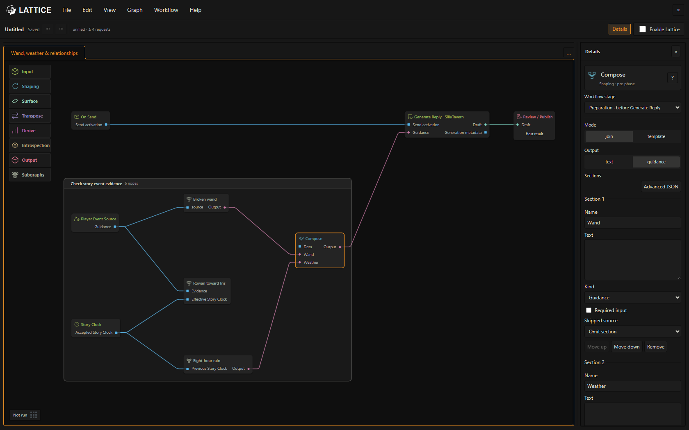
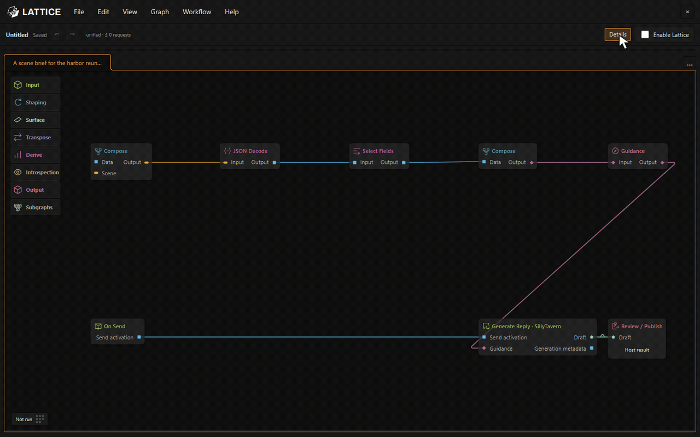
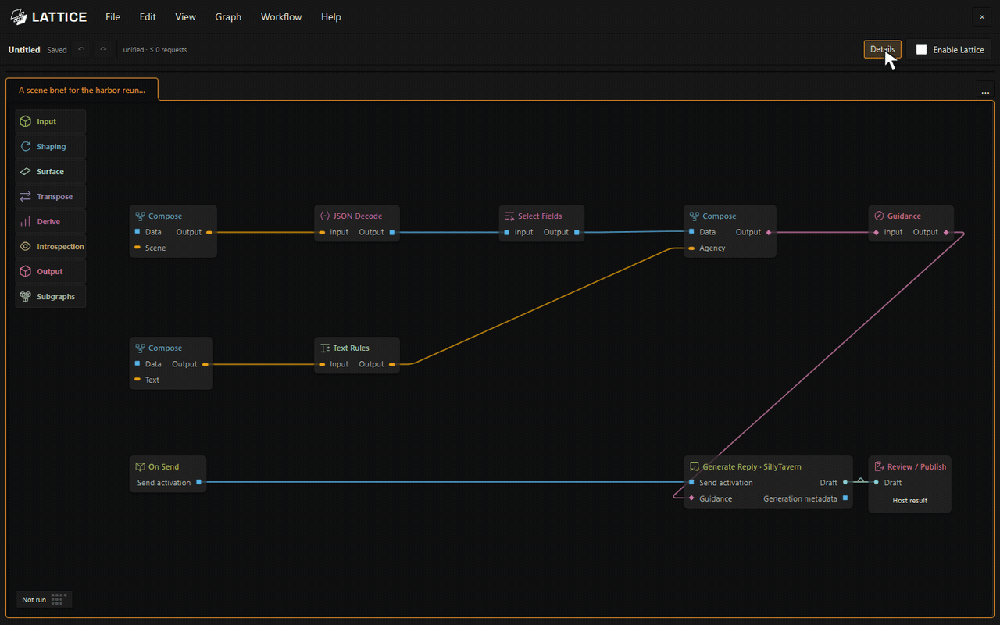
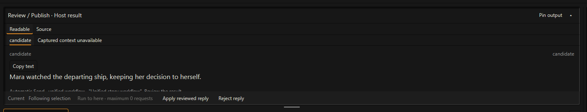

  

<strong>A visual story workshop for SillyTavern.</strong>

  <a href="#install-and-try-it">Install</a> ·
  <a href="docs/operators-manual.md">Operator’s manual</a> ·
  <a href="docs/developer-guide.md">Developer guide</a> ·
  <a href="LICENSE">MIT license</a>

Lattice lets you connect small tools to shape a roleplay: prepare the next scene, give a character their own perspective, edit a reply, or keep track of events your story has established. Start with a working example and change it to suit your world.

Your usual SillyTavern model writes the reply. Lattice can prepare guidance for it, ask other models to handle particular jobs, and process the result. You review the proposed reply and story changes before accepting them.

*Several story systems can share one workflow. Open a system to inspect its rules, edit it, or switch it off.*

## What could you build?

**A broken wand with a 10% chance of chaos magic.** Give ordinary magic a weight of 90 and fixed chaos effects a combined weight of 10: butterflies, sudden frost, whispering shadows. After an actual use is confirmed, Random Pick chooses an effect. The weighted choice needs no model request; models can recognize the action and narrate the consequence. A retained draw is reused for the same event. [Build this version](docs/story-systems.md#a-wand-with-a-10-chaos-chance).

| Story idea | How it works |
| --- | --- |
| **A relationship that develops over weeks** | Track separate trust, desire, tension, and excitement values. Set limits and cooldowns so one warm conversation has a modest effect. Use accepted story time to let temporary feelings settle. |
| **One moment, two private perspectives** | Give each present character their own context and memories when reflecting on a reunion, disagreement, or promise. Keep their private interpretations separate. |
| **Weather and routines on story time** | Advance a clock after an agreed journey or rest. Trigger rain, a curse, or a routine when the story crosses its scheduled time. |
| **A campaign notebook of accepted scenes** | Propose a recap or clue record alongside the reply. Save it when you accept that result, keeping rejected drafts out of the notebook. |
| **A narrator with an editorial team** | Have a model plan the scene, let SillyTavern write it, then ask an editor to polish the prose or add useful notes. Choose a connection for each job. |
| **Memories you can bring back deliberately** | Queue a character’s stored memories from the canvas or a shortcut, or use an authored story trigger. Inspect what reached the reply. |

These are systems you can author with the supplied tools and lessons. [Story systems](docs/story-systems.md) explains the setup and limits; [30 example workflows](docs/examples.md) offer editable starting points.

## Build it by connecting the pieces

Each box, called a **node**, does one job. Search for a tool and drag it onto the canvas. If a setup dialog opens, choose its settings and **Create node**. Connect its output to the next tool’s input. A workflow might read scene context, compose instructions, ask a model a question, edit text, or propose a saved story change.

*Search, drag, and configure. Select a node to edit its settings in Details.*

Click a node’s **?** button for an illustrated guide to its purpose, settings, connections, and examples. Preview shows recorded results along the way. **Run to here** tests a supported part of the workflow; a test that includes model tools can make additional requests.

When a useful sequence takes up too much space, turn it into a **subgraph**: one box that opens into its own editable tab. Save it to the shelf to reuse it in another workflow.

*Keep a working process together and reuse it without rebuilding its connections.*

## Review the result

The usual path is **Send → prepare guidance → SillyTavern reply → process → review**. Select **Review / Publish** and inspect its **Host result** in Preview. **Apply reviewed reply** adds the reviewed version as a new swipe, preserving the original, and accepts that result’s staged story changes. **Reject reply** leaves those proposals unaccepted.

*Reading Preview or using Run to here does not accept story changes. If a save fails, inspect its status before continuing.*

## Install and try it

With SillyTavern installed and your usual model connection working:

1. Open **Extensions → Install extension** in SillyTavern.
2. Enter `https://github.com/MentallyQuill/Lattice`. Leave the branch blank to install `main`, then reload SillyTavern.
3. Click the Lattice logo beside the chat bar, or type `/lattice`. A fresh installation opens **Unified story workflow** with Lattice disabled.
4. Select **Enable Lattice**, then send a player message normally. The starter uses your usual SillyTavern generation and makes no extra model requests.
5. Select **Review / Publish**, choose **Host result** in Preview, and apply or reject the reviewed reply.

Next, choose **File → Open examples…**. Try **Give this scene one clear direction** for a simple editable instruction, or choose a lesson that fits your story. Each lesson explains its setup and model request budget. Model-based lessons need their connections configured; some also need story documents in Workflow Data.

Lattice is in beta. Save your workflows and try substantial systems in a separate chat first. Update through SillyTavern’s **Manage Extensions**, then reload.

## Keep exploring

- [Quick start](docs/lattice-workspace.md) — installation, your first reply, and saving your work.
- [Operator’s manual](docs/operators-manual.md) — illustrated instructions for the editor and day-to-day use.
- [Example workflows](docs/examples.md) — choose among 30 lessons.
- [Unified workflows](docs/unified-workflows.md) — combine models, memories, documents, clocks, and story rules.
- [Model setup and troubleshooting](docs/native-workflows.md) — connections, request limits, and save status.
- [Documentation](docs/README.md) — routes for readers, workflow authors, and developers, including the detailed [node reference](docs/node-reference.md).
- [Developer guide](docs/developer-guide.md) — architecture, rendering, builds, and contributing.

Lattice is released under the [MIT license](LICENSE) so the AI roleplay community can use, adapt, and build on this technology, in part or as a whole. See [third-party notices](THIRD_PARTY_NOTICES.md) for included dependencies.

Screenshots and animations show the real editor on a local demonstration host with synthetic story material. The captures make no provider requests; model profiles shown are illustrative.
