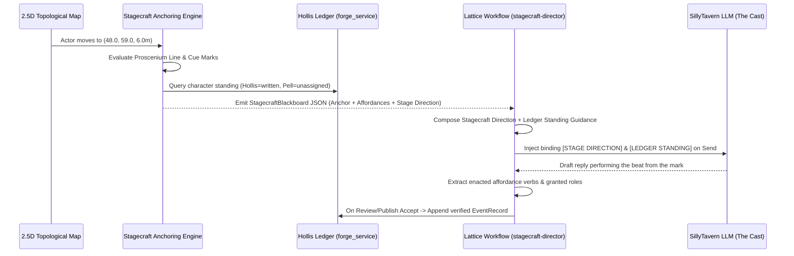

# Stagecraft Semantic Anchoring, Affordance Templates, and Acting in Lattice

## 1. Purpose & Architectural Premise

In SpriteQuest, spatial geometry (2.5D heightfields, floorplan coordinates, prop placements) and narrative performance (LLM dialogue generation, character standing, event logging) must never be conflated through ad-hoc scripts. Instead, **Lattice** acts as the **Stage Manager and Cognitive Orchestrator** that separates *where an actor is positioned* (cues, blocking, affordances) from *how the actor performs* (acting, dialogue, role compliance).

To ground this separation in battle-tested engineering rather than bespoke heuristics, this specification adapts four foundational frameworks from **cognitive robotics and Human-Robot Interaction (HRI)**:

1. **Semantic Anchoring** (*Coradeschi & Saffiotti, 2000–2003*): Maintaining a formal correspondence between continuous metric coordinates $(x, y, z, \theta)$ and symbolic predicates (`AtCue(mark_supplicant)`, `ProsceniumCrossed`, `StatusDifferential(supplicant_to_authority)`).
2. **Affordance Templates** (*Hart & Hambuchen, NASA / DARPA Robotics Challenge, 2014–2015*): Object-centric spatial templates that parameterize where an actor must stand relative to a fixture (`quartermaster_desk`, `weigh_table`, `gate-forfeit-wicket`) and what discrete action verbs become physically and diegetically permissible once anchored.
3. **Theatrical Robotics & Joint Action** (*Guy Hoffman & Cynthia Breazeal, MIT Media Lab*): Separating performance into a **Choreographic Blocking Layer** (pre-authored stage geometry, proscenium orientation, upstage/downstage status hierarchy, turn-taking preconditions) and an **Improvisational Acting Layer** (generative dialogue bounded by physical posture and co-actor gaze).
4. **Behavior Trees with a Shared Spatial Blackboard** (*Colledanchise & Ögren; ROS2 Nav2*): Reactive condition-and-action graphs where spatial predicates and ledger standing gate cognitive execution and route fallbacks.

---

## 2. Crossing the 4th-Wall Seam

Per `AGENTS.md`, this design explicitly accounts for both sides of the 4th-wall boundary:

### 2.1 The Diegetic Translation (In-World Lore & Mechanics)

In the world of SpriteQuest, theatrical stagecraft is not a metaphor—it is the administrative law of settled places:

* **The Proscenium Warrant**: Wild terrain outside a build plate is *Unscripted Wilderness*. When a traveller crosses the **Proscenium Line** into an adjudicated structure like the Border Customs House, they enter **Measured Stage**. Sightlines narrow from horizon roaming to dramatic framing.
* **Chalk Cue Marks & Standing**: Floorplans contain physical marks (`mark_hollis`, `mark_supplicant`). Occupying an **Upstage Authority Mark** (such as Hollis's $+0.6\text{m}$ elevated desk dais) requires a written part (`role.authored` / `written: true` in the Hollis Ledger).
  * **Hollis the Quartermaster** is twice-written; when anchored at `mark_hollis`, the paperwork obliges him to inspect and adjudicate.
  * **Pell the Underwritten** has no part above the first line (`unassigned` / `unreliable`). If Pell attempts to stand on an Upstage Authority Mark, the stage rejects the posture as an **Unwritten Usurpation**—he cannot operate the ledger or strike the seal, and is directed back to the wings (`forfeit_door`).
* **Affordance Sockets**: Fixtures on the stage (the Two-Pan Balance Scale, the Quartermaster's Ledger, the Forfeit Wicket) are governed by **Affordance Templates**. A character cannot invoke a fixture's verb from across the room; they must physically anchor within its interaction workspace and possess the standing required by its gate.

### 2.2 The Concrete Implementation (Engineering & Runtime)

* **Python Stagecraft Anchoring Engine** ([`companion/stagecraft_anchoring.py`](file:///home/nos/Nextcloud/SpriteQuest/companion/stagecraft_anchoring.py)):
  * Transforms local `stagecraft` definitions (`proscenium_line`, `playing_areas`, `cue_marks`, `sightlines`, `prop_sockets`) from scene floorplans (`library/floorplans/*.json`) into world space on the topological map.
  * Computes `SemanticAnchor` states, evaluates `AffordanceTemplate` preconditions against the actor's pose and Hollis Ledger standing, and synthesizes deterministic `StagecraftBlackboard` snapshots and injectable stage directions.
* **2.5D Web Parallax & Stagecraft Viewer** ([`companion/web/viewer.js`](file:///home/nos/Nextcloud/SpriteQuest/companion/web/viewer.js)):
  * Renders the Proscenium Line, Playing Area rings, and clickable Cue Marks (`★ Mark H`, `★ Mark S`) on the CSS 3D world plane.
  * Evaluates semantic anchoring in real time as the player moves via WASD/click, smoothly shifting camera perspective (`cam_proscenium_dialogue`) when crossing the proscenium and displaying active affordances and live stage directions in the HUD.
* **Lattice Stagecraft Director Workflow** ([`workflows/stagecraft-director.lattice.json`](file:///home/nos/Nextcloud/SpriteQuest/workflows/stagecraft-director.lattice.json)):
  * Reads both the `character-standing` ledger document and the `stagecraft-blackboard` spatial state.
  * Uses Lattice's native `json-decode`, `select-fields`, `format`, and `compose` operations to assemble a binding **Stage Direction & Standing Guidance** block injected into SillyTavern's `generate-reply` node.
  * Uses post-generation `extract`, `project-document`, and `write-file` gated by `review-publish` to record completed stage actions and newly granted roles.

---

## 3. Formal Data Contracts

### 3.1 Semantic Anchor (`SemanticAnchor`)

Represents Coradeschi & Saffiotti's symbol-to-percept anchor for a single actor at world pose $(x, y, z, \theta)$:

```json
{
  "actor_id": "player",
  "pose": { "x": 48.0, "y": 59.0, "z": 6.0, "facing_deg": 0.0 },
  "scene_id": "customs-house",
  "zone_id": "clearance-foyer",
  "proscenium_state": "on_stage",
  "playing_area": {
    "id": "downstage_entrant",
    "label": "Downstage Left (The Entrant / Traveller Mark)",
    "distance_m": 0.0
  },
  "anchored_cue_mark": {
    "id": "mark_supplicant",
    "label": "Mark S (Carrier / Trader)",
    "facing": "stage_right",
    "distance_m": 0.0,
    "standing_verdict": "authorized"
  },
  "status_differential": "supplicant_to_authority",
  "active_camera_vantage": "cam_proscenium_dialogue"
}
```

### 3.2 Affordance Template (`AffordanceTemplate`)

Adapts Hart & Hambuchen's NASA Affordance Template to stage props and sockets:

```json
{
  "id": "at-weigh-scale",
  "prop_id": "weigh_table",
  "label": "Inspection Weigh Table & Balance Scale",
  "world_pose": { "x": 48.0, "y": 63.0, "z": 6.0 },
  "reach_radius_m": 4.5,
  "required_standing": "any",
  "required_playing_area": "center_counter",
  "verbs": [
    {
      "verb": "weigh_cargo",
      "label": "Place crated assets on the balance pan",
      "stage_beat": "sets the cargo onto the zinc weigh table; the balance beam clatters"
    },
    {
      "verb": "present_manifest",
      "label": "Slide shipping slip across the zinc counter",
      "stage_beat": "slides the manifest across the scarred zinc counter toward the quartermaster's grille"
    }
  ]
}
```

### 3.3 Standing Gate on Cue Marks

| Cue Mark / Playing Area | Required Standing | Written Actor (`helps`) | Unwritten Actor (`unreliable` / `refuses`) |
| :--- | :--- | :--- | :--- |
| **`mark_supplicant`** (*Downstage Left*) | `any` | `authorized` (may petition or inspect) | `authorized` (may petition from below the line) |
| **`center_counter`** (*Center Stage*) | `any` | `authorized` (may weigh & strike) | `authorized` (may present goods for judgment) |
| **`mark_hollis`** (*Upstage Right Dais*) | `written` | `authorized` (commands the ledger & seal) | `unwritten_usurpation` (barred from the ledger; directed to wings) |
| **`forfeit_door`** (*Upstage Left Wings*) | `any` | `authorized` | `authorized` (default fallback for uncredited actors) |

---

## 4. Pipeline Execution Flow


