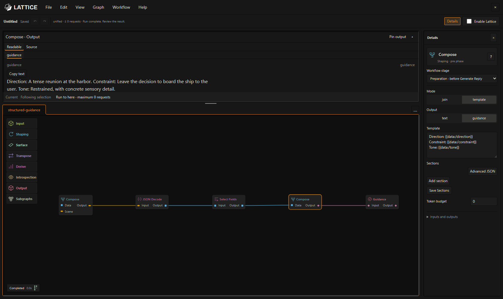
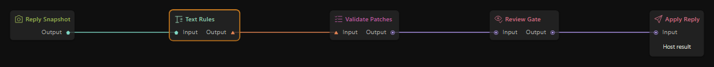

# Lattice quick start

[Documentation](README.md) · [Operator’s manual](operators-manual.md) · [Example workflows](examples.md)

This guide assumes SillyTavern is installed and your usual model connection works. Start with the supplied workflow, then add one small change.

## Install and open Lattice

1. In SillyTavern, open **Extensions → Install extension**.
2. Enter `https://github.com/MentallyQuill/Lattice`. Leave the branch blank to install `main`, then reload.
3. Click the Lattice logo beside the chat bar, or type `/lattice`.

A fresh installation opens **Unified story workflow** with Lattice disabled. Existing installations restore their recovery draft. **File → Recover previous workflows** offers earlier unified documents.

## Run your first unified workflow

The starter connects **On Send → Generate Reply · SillyTavern → Review / Publish**. Your usual SillyTavern connection writes the reply; the starter makes no extra model requests.

1. Open a practice chat and select the character who will reply.
2. In Lattice, select **Enable Lattice**.
3. Send a player message normally in SillyTavern and wait for the reply to finish.
4. Select **Review / Publish**. In Preview, choose **Host result** and compare the original with the proposed reply.
5. Choose **Apply reviewed reply** to add the reviewed version as a new swipe, or **Reject reply** to discard the proposal. The original reply remains available.

A workflow can also propose memories, notes, clock movement, or other saved story changes. Apply accepts the effects attached to that reviewed result; Preview alone does not. Inspect each save’s status if a workflow writes data.

**Run to here** tests the supported inputs needed for a selected output. It does not start another main reply or accept story changes, but model tools on that path can make requests. **Workflow → Stop workflow** cancels active work.

## Try one scene instruction

Choose **File → Open examples… → Give this scene one clear direction**. Select **Text · scene direction** and replace its instruction in Details, for example:

> Describe the dark lighthouse and one sound from the water. Leave my next action to me.

Follow the connections from Text through Compose to Generate Reply’s guidance input. Right-click Compose and choose **Run to here** to inspect the guidance in Preview. Then send your next player message and review the result.

Opening a lesson creates an editable copy. It makes no model request and does not change **Enable Lattice**. Each of the [30 lessons](examples.md) states its setup and request budget. For model-based lessons, choose each model tool’s connection on its grey bar; **For Each** helpers have separate bindings in Details.

Click a node’s **?** button for its guide. It explains the job, settings, connections, and examples without leaving the editor.

## Save your work

Use **File → Save workflow** or **Save As…** to keep an editable file. In browsers without direct file access, Save As downloads a JSON copy. The document stays marked modified because Lattice cannot confirm the download finished.

A recovery draft keeps saved editor changes across reloads, but does not update your file on disk. **Open Recent** reopens previously accessed files in supported browsers. **Export workflow JSON…** creates a sharing copy without local connection identifiers or credentials. See [save, import, and share](operators-manual.md#save-import-and-share).

## Find your way around

Use **Graph → Add node…** to search the shelf and place a node immediately. A red border and wrench labeled **Setup Required** identify missing settings; activate the wrench to open Details. An amber **Input Required** indicator identifies required wiring. Connect output pins to compatible inputs; the connections decide which results feed the next step. Canvas position does not decide execution order.

**View → Fit graph** and **Fit selection** bring your work into view. Press **F** to fit the selection, or the whole graph when nothing is selected. The default **Ember** theme follows SillyTavern’s colors. **View → Theme and colours…** offers other themes; Harbor and Signal include connection patterns and labeled, shaped pins.

*Preview lets you inspect the result of a step before sending a reply. This demonstration uses a structured scene brief.*

## Use automatic Workflow Data

Add **Story Clock**, **Read File**, or **Outcome Commit** to use their automatic sources:

| Node | Starting source |
| --- | --- |
| Story Clock | **Chat clock**: Day 1 at 00:00, with a 24-hour day. |
| Read File | **Chat notes**: empty plain text. |
| Outcome Commit | **Chat outcomes**: an empty JSON list. |

Lattice makes the referenced defaults available when the enabled workflow runs. Change starting values or content in Details; **Advanced** lets you choose a source, format, and visibility. Actor-private sources also require an actor ID. Clock and outcomes keep their required JSON format.

Starting values seed unsaved data. Changing them does not overwrite saved time, notes, or outcomes. Nodes choosing the same clock share its timeline; separate clocks do not synchronize automatically.

For named documents required by a lesson, open **Workflow → Configure → Workflow Data…**. These are story documents stored with the chat, not arbitrary files on your computer. See [document setup](unified-workflows.md#authorize-workflow-data-and-preserve-its-structure).

## Add a reusable system

Once a process works, save it as a subgraph and choose **Workflow → Add system…**. Select a saved revision and add its editable instance immediately. Use the wrapper's **Configure system connections…** action afterward to adjust exposed values, choose inputs and output destinations, and preview the proposed connections. Placement and later connection assistance have separate Undo steps.

Select the system’s wrapper and use **Details → Run this system** to include or skip it. Closing the tab only changes your view. Keep one main reply and one final Review / Publish path. The [combined systems example](combined-system-example.md) shows a wand, weather, and relationship state sharing a workflow.

## Inspect an editorial process

*This demonstration proposes text replacements. Run to here shows the replacements and protected text without publishing them.*

Patch validation and candidate inspection are intermediate checks. A reply-processing workflow must carry its final Draft to **Review / Publish** before you can apply it. See [reply review](native-workflows.md#review-a-reply-repair).

## Recover an older setup

Retired pre/post workflows are kept in an archive. **File → Export archived workflows** saves their original graphs, bindings, and active selection as a recovery copy. They cannot run or import as current workflows. Rebuild useful parts in a unified workflow with Preparation and Response stages and a final Review / Publish. Recovery makes no model requests and does not convert the old graphs.

Continue with the [operator’s manual](operators-manual.md) for illustrated editor instructions, or [unified workflows](unified-workflows.md) to build a complete story system.
