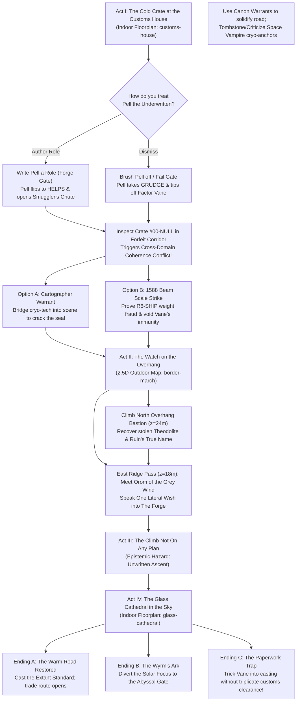

# The Unwritten Consignment
### *A Four-Act Frontier Mini-Campaign for SpriteQuest*

> **Adventure Pitch:** A midnight rockslide on the Border March has exposed an ancient 45-degree ruin, a smuggled cryogenic coffin is freezing the floor of the Forfeit Corridor, and the road north to the Glass Cathedral is literally *unloading* into raw grey void because someone stole the Cartographers' Canon Warrant. You have until sundown—when the Mercantile Factor of House Kestrel claims diplomatic forfeiture—to recruit an underwritten actor, bargain with a stone-walking giant who grants wishes *far too literally*, and climb a tower that does not appear on any plan before its lens rewrites the valley into absolute zero.

---

## 1. Cast of Characters (Dramatis Personae)

| NPC | Faction / World | Starting Standing | Roleplay Hook & Secret |
| :--- | :--- | :--- | :--- |
| **Hollis the Twice-Written** | *The Scaffolded Kingdom* (`customs-house`) | `written` / `helps` | Unshaven quartermaster in chainmail under a clerk's coat; his left shoulder is an unmodelled polygon block. Obsessed with the 1588 bell weights and balancing his two-column ledger. **Secret:** He let Crate `#00-NULL` into the foyer on credit because the carrier promised it contained the missing payroll from the Neighboring Kingdom. |
| **Pell the Underwritten** | *The Neighboring Kingdom* (`neighboring-kingdom`) | `understudy` (`waits` $\to$ `helps` or `refuses`) | Earnest young performer in a plain tunic clutching a script that is blank below line one. **Mechanic:** If treated like a nameless hireling, Pell takes a **Grudge** (`refuses`) and bolts the stage door. If you author a real named part for him in the Ledger (e.g., *Sworn Searcher of the Gap* or *Bearer of the Unwritten Mark*), he becomes your boldest companion. |
| **Surveyor-Senior Vellum** | *Bureau of the Unwritten Atlas* (`cartographers`) | `provisional` | Ink-stained bureaucrat in a waxed greatcoat whose brass astrolabe spins wildly whenever anyone tells a lie or walks near unrendered ground. **Want:** Needs a verified **Canon Warrant** to re-certify the northern road before "context rot" swallows the customs plateau. |
| **Factor Vane of House Kestrel** | *The Space Vampires* (`space-vampires`) | `enemy` (under truce in Act I) | Porcelain-skinned factor in vacuum-tight obsidian robes, frost clinging to his collar, tapping a silicon tablet that computes Nash equilibria in real time. **Want:** Legally claim the impounded **Hexagonal Borosilicate Stasis Coffin** at sundown and haul it up to the **Glass Cathedral's Solar Focus** to extinguish all "wasteful biological heat" in the valley. |
| **Orom of the Grey Wind** | *The Grey Wind* (`grey-wind`) | `neutral` | Nine-foot tall being of matte slate-grey skin who steps out of solid granite cliffs like fog. Never fights; has infinite patience. **Mechanic:** Will condense **one spoken wish** into a heavy slate tablet—interpreted with the coarse, literal precision of **The Forge**—in exchange for recovering the *True Name of the Seventh Ruin* from the northern bastion. |
| **The Obsidian Wyrm** *(Voice in the Glass)* | *The Abyssal Citadels* (`obsidian-wyrm`) | `neutral` / `hazard` | An ancient dragon of volcanic glass and starfire trapped half-way through a fractured solarium mirror in Act IV. **Want:** Wants you to aim the Cathedral's astronomical lens into the Abyssal Gate—saving a time-capsule of civilization, but scorching the Border March to ash. |

---

## 2. Campaign Flowchart & Faction Pressure

---

## 3. Act-by-Act Adventure Breakdown

### Act I: *The Cold Crate at the Customs House*
**Location:** `library/floorplans/customs-house.json` (Foyer, Weigh Hall, Quartermaster's Office, Forfeit Corridor)

> *Read-Aloud:*
> *"Rain needles the zinc roof of the Border Customs House, though if you look too closely at the north window, the rain stops three feet outside the glass where the matte-painted backdrop hasn't been hung yet. Inside the Intake Foyer, breath hangs white in the air. A trail of blue hoarfrost creeps out from under the iron wicket of the Forfeit Corridor. Behind the oak counter, Hollis the Twice-Written is furiously tapping a 1588 brass bell-weight against his ledger, while a pale nobleman in obsidian robes—Factor Vane—watches a pocket hourglass with unblinking eyes."*

#### Playable Encounters & Decisions
1. **The Two Questions at the Counter (Social / Investigation):**
   - Hollis explains his bind: Factor Vane declared **Crate `#00-NULL`** as *"One (1) Pine Bounding Box, Standard R6-SHIP, containing salted turnips."* By statute, Hollis cannot open a sealed R6-SHIP crate unless:
     - **Path A (The Strike):** Someone helps him haul the 400-lb frost-rimed crate onto the **Beam Scale** in the Inspection Hall (`strength` / physics push mechanic) and proves its mass violates the manifest, OR
     - **Path B (The Cartographer's Audit):** You accompany **Surveyor Vellum** into the Forfeit Corridor to perform an **Epistemic Survey** on the crate, exposing that the pine slats are merely bolted around a **Hexagonal Borosilicate Glass Stasis Coffin** (`glass_stasis_coffin`).
2. **Recruiting Pell the Underwritten (The Understudy Loop):**
   - In the side alcove by Cue Mark `mark_supplicant`, **Pell** is memorizing a single line: *"Halt, who goes—"* before staring helplessly at three blank pages.
   - **Fun Table Moment:** The player gets to literally **write Pell's character role** (via SillyTavern prompt / Ledger promotion). Want Pell to be a dashing ex-smuggler who knows the secret lock on the Forfeit Wicket? Write it! Want him to be a disgraced apprentice of the Wizard's Tower who can read the coffin's telemetry as "cold runes"? Write it!
3. **The Coherence Backpressure Mechanic in Action:**
   - When the outer pine slats fall away in the Forfeit Corridor, the **Glass Stasis Coffin** triggers a live **Cross-Domain Coherence Conflict** (sterile zero-entropy Space Vampire tech clashing with damp medieval flagstone).
   - Until resolved, the coffin is "unanchored" in the scene—weapons glance off its refractive blur. By **Curating** the bridging fragment (`cartographers/bridge-glass-stasis-coffin-forfeit-corridor`), you lock the coffin into the physical rules of the room, allowing you to pry loose its **Single-Crystal Silicon Cipher Key**—just as Factor Vane's cryo-servitors blow the intake doors and flee uphill with the coffin toward the eastern pass!

---

### Act II: *The Watch on the Overhang & The Grey Wind's Bargain*
**Location:** `library/maps/border-march.json` (The 2.5D Outdoor Terrain: Lowlands, Customs Plateau, Eastern Ridge Pass, North & West 45° Overhang Ruins)

> *Read-Aloud:*
> *"Outside the Customs House, the frontier rises in steep, stepped strata of slate and alpine scree. To the northwest, a monolithic stone bastion leans outward at an impossible forty-five-degree overhang—defying gravity only because the ancient builders knew the world's overhang rule could not reject forty-five degrees. To the east, a narrow saddle cuts between twenty-two-meter granite peaks, where mist stands completely still against the wind."*

#### Playable Encounters & Decisions
1. **Cat-and-Mouse in 2.5D Elevation & Line-of-Sight:**
   - Factor Vane's party is hauling the Stasis Coffin up the **Eastern Ridge Pass** ($x=90\text{m}, y=30\text{–}120\text{m}$).
   - Vane has stationed two **Cryo-Sharpshooters** with thermal lenses on the **West Watch Ruin** ($z=18\text{m}$). Using the map's real-time **Elevation LOS & Fog-of-War**, the player must use the Customs Plateau ($z=6\text{m}$) and ridge flanks ($z=22\text{m}$) as sightline cover to flank them.
2. **The Relic Cairn on the 45° Overhang (`prop-relic-cairn`):**
   - Climbing the **North Ancient Bastion** ($x=24\text{m}, y=24\text{m}, z=24\text{m}$) rewards you with commanding sightlines over the entire map and two crucial discoveries:
     - Surveyor Vellum's stolen **Calibrated Theodolite** (needed to stabilize the road in Act III).
     - A weathered slate tablet inscribed with the **True Name of the Seventh Ruin**: *Aethel-Vorn, the City That Wished For No More Winters* (which the Grey Wind answered by turning the city into timeless, seasonless stone).
3. **Orom of the Grey Wind & The Literal Wish (The Forge Puzzle):**
   - Halfway through the Eastern Pass, **Orom** steps directly out of the solid cliff wall. Vane tried to calculate a game-theoretic bribe with Orom and was ignored—because Orom is content to wait ten thousand years for a better conversation.
   - If you give Orom the slate tally from the Cairn, Orom holds out a broad slate-grey palm (`grey-wind/wish-granting`) and asks: ***"Speak what you wish to be fact upon this mountain."***
   - **How this plays with SQ Tools:** The player's spoken wish is fed into **The Forge + Fragment Compiler** to generate a real, physical **Wish-Stone Prop / Fragment** on the map! Because the Grey Wind (and The Forge) answer wishes *coarsely and literally*, if the player wishes for *"a weapon to stop the cold,"* they might receive an **Ever-Burning Brazier-Mace**; if they wish for *"the road to the tower to be open,"* a slab of sheer heart-granite bridges the chasm ahead!

---

### Act III: *The Climb That Is Not On Any Plan*
**Location:** *The Unwritten Ascent* (The seam between the Border March and the Mount)

> *Read-Aloud:*
> *"Past the northern milestone, the cobblestones simply stop. Ahead of you is a draftman's nightmare: faint plumb-lines of glowing brass hang in mid-air over a drop of pale, untextured fog. Every few yards, a stone stair-step flickers between 'provisional' wireframe and solid granite. A signpost at the brink reads: ROAD UNLOADABLE — PRESENT CANON WARRANT OR TURN BACK."*

#### Playable Encounters & Decisions
1. **Epistemic Warfare (Curate vs. Criticize):**
   - Factor Vane is using **Entropy Beacons** to inject "provisional" Space Vampire fragments into the ascent—turning the mountain air into vacuum and freezing the stairs into frictionless black crystal.
   - Here, the **Cartographers' Curation & Criticism UI** becomes an active gameplay mechanic!
     - **Criticize (Delete / Tombstone):** When you smash an Entropy Beacon and **Delete/Criticize** its provisional fragment in the viewer, the Cartographers' Ledger records a permanent **Tombstone** (`refined_by_criticism`)—the vacuum zone collapses and can *never* be re-synthesized by the enemy!
     - **Curate (Warrant):** By editing and stamping the bridge fragments with Vellum's **Canon Warrant**, the flickering stairs lock into `canon_locked` solid granite up to the clouds.

---

### Act IV: *The Glass Cathedral in the Sky*
**Location:** `library/floorplans/glass-cathedral.json` (Outer Sky Portico, Grand Nave of Blown Glass, East/West Solariums, High Chancel & Solar Focus)

> *Read-Aloud:*
> *"You step through the spun-glass arch of the Narthex into a cathedral two hundred and forty meters long, blown from a single solar-melted asteroid. Sixteen fluted glass columns forty-five meters tall catch the high-altitude sun, throwing blinding prismatic spears across the floor. At the far north end, three meters above the nave on the Chancel dais, Factor Vane has cracked open the Stasis Coffin—and the tall, frost-crowned figure rising from the superfluid is already turning the great Astronomical Lens toward the valley below."*

#### The Climax & Three Ways to Win
1. **The Acoustic & Prismatic Arena:**
   - The **Grand Nave** has `cathedral` acoustic reverb and sixteen glass columns (`colonnade-west`, `colonnade-east`). Taking cover behind the columns shields you from the Solar Focus's beam, while the **West & East Solariums** ($z=+1.5\text{m}$) hold alignment mirrors that can redirect the beam!
2. **The Tower's Six Beats of a Cast (`wizard-tower/first-cast-beats`):**
   - Remember the deep lore of **The Mount**: *The tower has no wizard. It is a civic instrument. Anyone who takes the Extant Standard from the shelf, declares intent at the focal plane, and sends the paperwork to the customs counter in triplicate afterwards can make a Cast—where the room does not change, and the world is.*
3. **Choose Your Resolution:**
   - **Resolution 1 — *The Customs Loophole (Wit & Bureaucracy)*:** Remember Beat 6 of the Tower (`the paperwork goes to the customs counter afterwards, in triplicate`) and Hollis's R6-SHIP rule (`no box, no clearance`)! If Hollis or Deputized Pell stamps a **Writ of Forfeiture** on the Stasis Coffin *before* the Solar Focus completes its cast, the entire Space Vampire consignment is legally reclassified as **Unclaimed Stock** under `find.py` flags—teleporting the coffin straight back into the Customs House yard vault, harmlessly impounded!
   - **Resolution 2 — *The Obsidian Wyrm's Gambit (High Drama & Sacrifice)*:** Rotate the **West Solarium** mirror toward the fractured glass where the **Obsidian Wyrm** presses her star-filled eye against reality. The stolen heat of the Space Vampires' coffin is vented through the **Abyssal Gate** to power her eternal citadel, banishing Vane's house forever—at the cost of leaving a permanent volcanic glass scar across the eastern pass.
   - **Resolution 3 — *Pell's Final Line (Heroic Stagecraft)*:** Pell takes the **Chancel Cue Mark** at the focal lens and speaks the ending you wrote into his script in Act I—using the **Extant Standard** and Orom's **Wish-Stone** to cast a permanent, warranted summer road connecting the Neighboring Kingdom and the Scaffolded Kingdom.

---

## 4. How We Bring This Campaign to Life with SpriteQuest Tools

To turn this from a document into a playable experience inside SillyTavern + the 2.5D Map Viewer, here is the build order we can execute right now:

### Phase 1: The Campaign Manifest & Act Switcher (`library/campaigns/unwritten-consignment.json`)
- Create a structured **Campaign Module JSON** that links the 4 Acts, their maps/floorplans (`customs-house`, `border-march`, `glass-cathedral`), starting NPC states, quest beats, and collectible fragments/warrants.
- Add an **Act / Scene Selector** in the 2.5D Map Viewer header so you (or a Lattice workflow node in SillyTavern) can transition the party from **Act I (Customs House)** $\to$ **Act II (Border March Outdoor)** $\to$ **Act IV (The Glass Cathedral in the Sky)**!

### Phase 2: Playable Encounters, Cutscenes & Interactive Choices in the Viewer
- Expand the **Cutscene & Stagecraft Engine** (`stagecraft_anchoring.py` & `viewer.js`) from a single static demo button into **Act-based Interactive Beats**:
  - **Beat 1 (The Foyer Standoff):** Hollis, Pell, Factor Vane, and Surveyor Vellum take their marks; clicking an NPC or prop offers actionable campaign choices (e.g., *Weigh Crate #00-NULL*, *Deputize Pell*, *Survey Coffin Anomaly*, *Speak Wish to Orom*).
  - **Beat 2 (The Overhang Climb & Wish Forge):** Add **Orom of the Grey Wind** and **Factor Vane** as compiled faction NPCs (`companion/npcs/`) on the `border-march` outdoor map, with an interactive **"Speak a Wish to the Grey Wind"** input that runs the Fragment Compiler + Forge to materialize your wished item in the scene!
  - **Beat 3 (The Glass Cathedral Climax):** Make `library/floorplans/glass-cathedral.json` selectable and playable in the 2.5D viewer with its 16 asteroid-glass columns, solarium mirrors, and the Chancel Solar Focus!

### Phase 3: SillyTavern Lattice Workflow & Worldbook Integration
- Wire the campaign state (`/campaign/state` on `forge_service.py`) into `guidance` so the SillyTavern narrator LLM automatically knows:
  - Which Act you are in and where you are standing on the map,
  - Whether Pell is still an `understudy`, holds a `grudge`, or has been `written` into a hero,
  - Which fragments have been **Warranted** or **Criticized/Tombstoned** by the player, and
  - What literal **Wish-Stone** you forged with the Grey Wind!
