# LATTICE operator's manual

[Documentation](README.md) · [Quick start](lattice-workspace.md) · [Story systems](story-systems.md) · [Node reference](node-reference.md) · [Model setup](native-workflows.md)

Lattice lets you arrange small tools around a SillyTavern reply. You can give the next scene a direction, polish the narration, remember an event, or keep a story notebook. Start with the first few sections; the later sections explain how to build and reuse more involved systems.

This manual assumes SillyTavern is already installed and you can send a normal message. It follows the 0.27.0 beta interface. The illustrations show the real editor with demonstration story material; the connection names shown are examples.

## Install Lattice

1. In SillyTavern, open **Extensions → Install extension**.
2. Enter `https://github.com/MentallyQuill/Lattice`. Leave the branch field blank to install `main`.
3. Finish installation and reload SillyTavern.
4. Click the **Lattice logo beside the chat bar**, or type `/lattice`.

A fresh installation opens **Unified story workflow** with Lattice disabled. You can look around and edit it before enabling it. Update Lattice through SillyTavern's **Manage Extensions**, then reload.

## Contents

- [Orient yourself](#orient-yourself)
- [Your first Send and review](#your-first-send-and-review)
- [Start from a working example](#start-from-a-working-example)
- [Discover and connect nodes](#discover-and-connect-nodes)
- [Navigate and edit the graph](#navigate-and-edit-the-graph)
- [Configure operations in Details](#configure-operations-in-details)
- [Run and inspect results](#run-and-inspect-results)
- [Review a proposed reply edit](#review-a-proposed-reply-edit)
- [Save, import, and share](#save-import-and-share)
- [Develop your own writing system](#develop-your-own-writing-system)
- [Reuse a process with subgraphs](#reuse-a-process-with-subgraphs)
- [Organize connections with portals and reroutes](#organize-connections-with-portals-and-reroutes)
- [Troubleshoot a workflow](#troubleshoot-a-workflow)
- [Keyboard and connection reference](#keyboard-and-connection-reference)

## Orient yourself

A **node** is one of the boxes on the canvas. Each does a particular job. A **wire** carries a result from one box to the next. The connected process is your **workflow**. Lattice calls the whole canvas a **graph** in its menus.


*Select a box in the graph to configure it in Details on the right. After a run, Preview above the graph shows what that box produced.*

| Area | What you do there |
| --- | --- |
| Menu bar | Open and save workflows, edit the graph, find tools, and change the view. |
| Workflow bar | Check the document name and saved status, undo/redo, open Details, stop work, and enable Lattice. |
| Preview | Read results from a run and review the final reply. |
| Graph tabs | Switch between Main and the inside of a reusable system. Main is the whole workflow. |
| Canvas | Move nodes and connect their input and output pins. |
| Node shelf | Browse tools by family or find a saved subgraph. |
| Details | Change the selected node's settings and open its **?** guide. |
| Run meter, bottom left | See progress and open a report of what ran. |

The menus group the main actions:

| Menu | Main actions |
| --- | --- |
| File | New, Open, examples, recovery, Save, import, export, and Close workspace. |
| Edit | Undo, redo, copy, cut, paste, duplicate, delete, and selection. |
| View | Show/hide panels, follow or pin Preview, fit the graph, and choose a theme. |
| Graph | Add nodes, rename, group, make subgraphs, add comments, and manage portals. |
| Workflow | Enable Lattice, validate, review the result, inspect a run, add systems, and manage Workflow Data or recall. |
| Help | Workspace guide, node reference, shortcuts, and version. |

**Enable Lattice** makes the open workflow participate when you use SillyTavern's normal **Send**. Opening or saving a workflow does not switch this setting. Opening a different workflow changes which document Send will use, so check the name in the workflow bar before sending.

The usual process is:

**Send → prepare guidance → SillyTavern writes a reply → process the reply → review.**

**Preparation** means work before **Generate Reply · SillyTavern**. **Response** means work after it. A unified workflow keeps both in one canvas. Your normal SillyTavern connection still writes the main reply.

## Your first Send and review

The fresh **Unified story workflow** contains only three nodes. It makes **no extra model calls** beyond your usual SillyTavern reply.

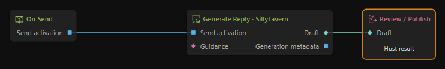

*On Send starts the process. Generate Reply uses your normal SillyTavern generation. Review / Publish gives you the final result to inspect.*

1. Select a practice chat and character in SillyTavern.
2. Keep **Unified story workflow** open and select **Enable Lattice**.
3. Send a player message in SillyTavern as usual. Wait for the reply and Lattice processing to finish.
4. Select **Review / Publish**. In Preview, open its **Host result**. If there is more than one output, choose the intended one.
5. Read the result. Choose **Apply reviewed reply** to accept it, or **Reject reply** to decline Lattice's proposed result.

Apply adds the reviewed reply as a **new swipe**, preserving the original SillyTavern reply. Reject does not remove the original reply that SillyTavern already generated. When you later add notebooks, clocks, or memory updates, Apply also accepts the changes attached to this reviewed result; Reject leaves those proposals unaccepted.

These actions have different purposes:

| Action | What happens |
| --- | --- |
| **Send** in SillyTavern | Starts the complete enabled workflow around a normal reply. |
| **Run to here** | Tests a supported part of the graph and records its output. Model nodes on that path can make extra calls. It does not publish a reply or accept story changes. |
| **Apply reviewed reply** | Accepts the current reviewed reply and its attached proposals. |
| **Reject reply** | Declines the reviewed result and the pending changes that wait for its acceptance. |
| **Stop** | Cancels active work. An answer arriving after cancellation cannot resume that run. |
| **Save workflow / Save As…** | Saves your workflow design. It does not run it or accept a story result. |

If you disable Lattice, normal SillyTavern Send continues without this workflow. Closing the workspace retains the current draft and view; use **Enable Lattice** to control integration.

## Start from a working example

Examples are editable lessons. Begin with **1 · Follow a reply from Send to Review** if you want to repeat the starter walkthrough. Then try **2 · Give this scene one clear direction**.

1. Choose **File → Open examples…**.
2. Search for a story goal or filter by difficulty.
3. Open the lesson's details. Read its setup, steps, checkpoints, and model-call budget.
4. Open the lesson. Lattice makes a fresh copy for you to edit.

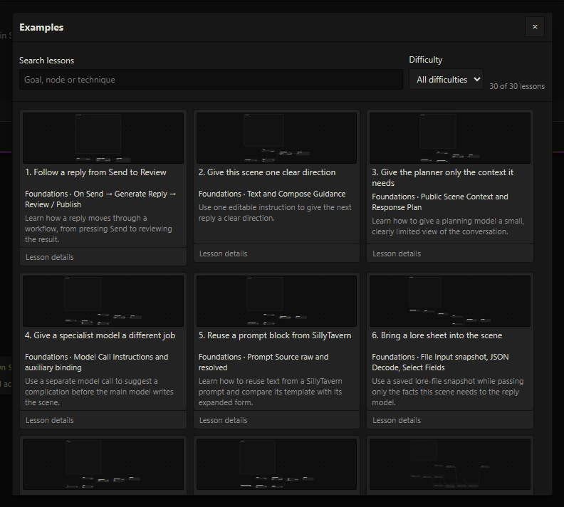

*Choose a beginner lesson or search for the story job you want to try. Each opening gives you a new independent copy.*

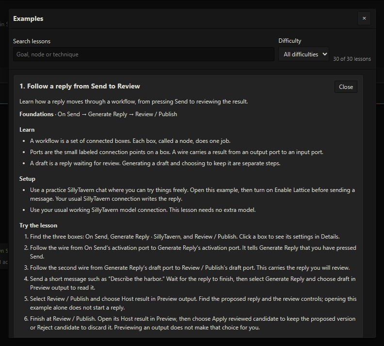

*Check the requirements before opening. Extra model calls are separate from the normal SillyTavern reply.*

Opening a lesson replaces the open document after offering to save modified work. It does not run the example or change **Enable Lattice**. The [30-lesson guide](examples.md) lists later topics, including notes, memories, clocks, item effects, and relationships.

### Try lesson 2: give the next scene a direction

Lesson 2 needs no additional model connection. Its **Text** node contains words you write yourself, and **Compose** turns them into **Guidance** for Generate Reply.

1. Open lesson 2 and select **Text · scene direction**.
2. In Details, replace its text with: “Describe the dark lighthouse and one sound from the water. Leave my next action to me.” Move focus out of the field to commit the edit.
3. Follow the wire from Text to Compose, then from Compose to Generate Reply's Guidance input.
4. Right-click Compose and choose **Run to here** for its output. Read Preview: it should contain your lighthouse instruction. This prepares advice without generating a chat reply.
5. With Lattice enabled, Send “I arrive at North Harbor.” in SillyTavern.
6. Inspect the finished reply at **Review / Publish**, then Apply or Reject.

Try changing the direction to wind and distant bells, and run Compose again. The next Send uses the new instruction. A previous result becomes **Stale** when you change the instruction, because it was produced from the old wording.

### Learn any tool from its question-mark button

You do not need to memorize the node library. Select a node and click **? beside its name in Details**. Its guide explains the job, connections, settings/options, and a worked example.

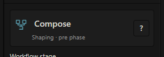

*This is the first place to look when a setting or pin is unfamiliar.*

Expand **Example** in the guide. You can explore the small graph, then choose **Add example to current tab** to insert it into the graph you are editing. Check its connections and setup before running it; one Undo removes the insertion. The [node reference](node-reference.md) is available for precise formats and a complete list of tools.

## Discover and connect nodes

The node shelf groups tools into **Input, Shaping, Surface, Transpose, Derive, Introspection, Output, and Subgraphs**. Click or hover over a family to see its tools, then choose one.

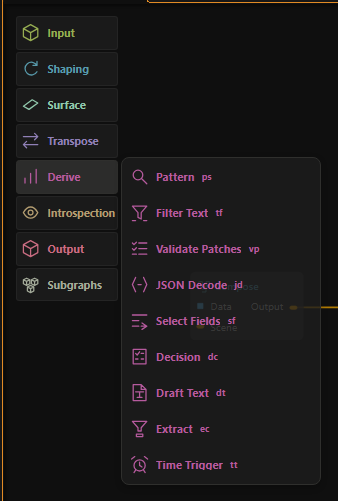

*Browse a family when you know the kind of job. Disabled choices cannot be used in the current location or stage.*

### Search and drag from the shelf

Choose **Graph → Add node…**, double-click empty canvas, or right-click empty canvas to search. Search understands names, purposes, and aliases as well as installed subgraphs. Type **Text Rules**, for example, and drag the result to an empty place on the canvas.


*Drop places the node at that position. Select it to edit its settings in Details.*

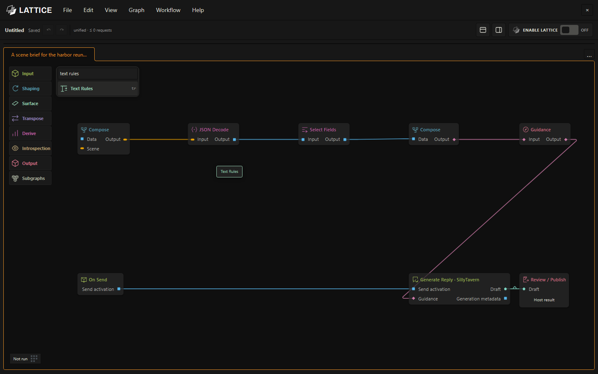

*The floating label shows what you are about to add. Escape or releasing outside the canvas cancels placement.*

Every available tool places immediately, including tools that still need an actor, a helper, a model, or authorized story data. Placement starts no workflow and makes no model request. Select the placed node to edit its settings in **Details**. One Undo removes the placement; later settings saves have their own Undo steps.

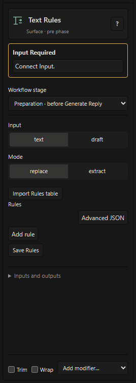

*Edit the input and rules on the placed node. Read its guide from the ? button beside its name.*

A red border and wrench marked **Setup Required** mean settings are missing. Click the badge to open the reasons in Details. You can save one valid field while other required fields remain empty. Invalid JSON or other unfinished text stays in the editor until corrected; it does not replace the saved setting. Closing Details keeps the node.

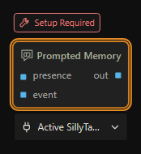

*Prompted Memory is already on the canvas while its Actor id is empty.*

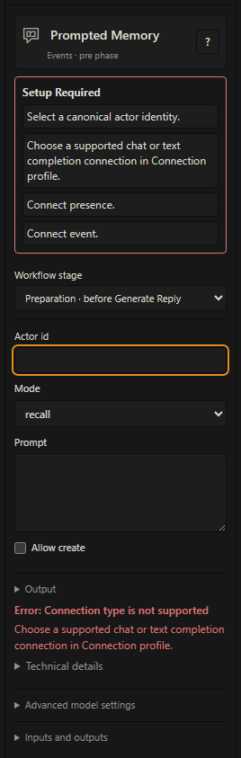

After the last missing setting is saved, an unconnected required pin shows a plug and **Input Required**. Connect the named input to continue. These badges describe current authoring requirements; running still checks the requested path and current access before doing work.

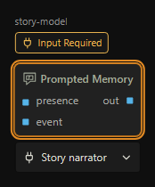

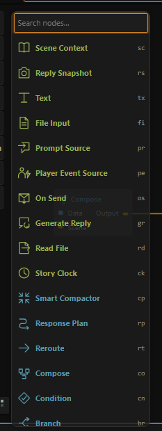

*Click outside the chooser or press Escape to close it.*

A tool may have several modes in Details instead of several shelf entries. For example, **Reflect** offers Character, Recall, and Scene modes; **JSON Decode** offers Parse and Check. Open **?** to learn the selected mode before configuring it.

### Connect outputs to inputs

Pins are the small connection points on a card. Drag an **output on the right** onto a compatible **input on the left**. A result may feed several nodes, but each input accepts one connection.

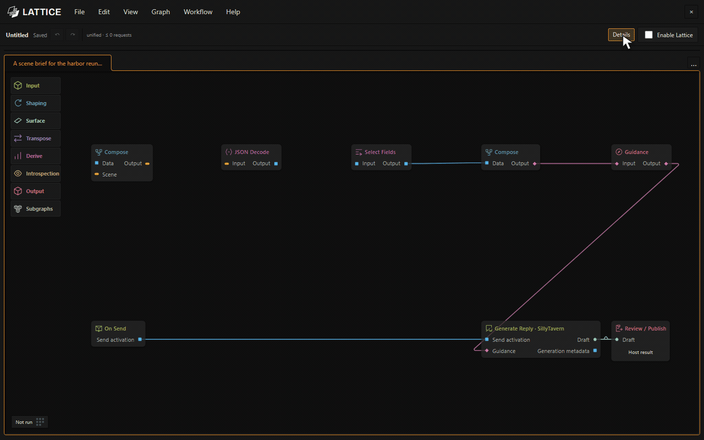

*Drag from the result you have to the input that needs it.*

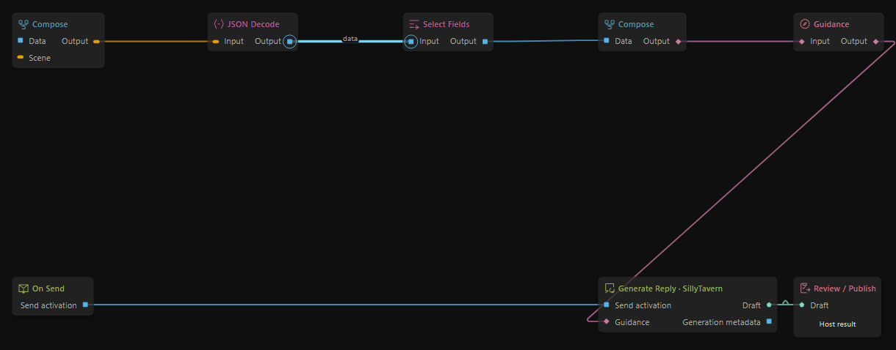

*JSON written as Text must pass through JSON Decode before Select Fields can use it as Data.*

You can also drag a pin into empty space to search for a new connected node. Leave **Context sensitive** enabled to show suitable choices. If the new node has several compatible pins, choose the input you intend to use.

Pins carry particular kinds of material. Lattice uses the term **artifact** for a result with its type and supporting information.

| Type | Practical meaning |
| --- | --- |
| **Context** | A set of story messages or other context with their source information. |
| **Text** | Written words, such as an instruction, template, or note. |
| **Data** | Structured values: fields, lists, records, events, or state. |
| **Guidance** | Advice prepared for generation, with checks on its source and intended character. |
| **Draft** | A reply linked to the original message, so permitted edits can be reviewed. |
| **Findings** | Issues or observations from an inspection. |
| **Patches** | Proposed edits to a particular Draft. |
| **Candidate** | A checked proposed revision for inspection. Final publication still happens at Review / Publish. |

Colors, shapes, labels, and wire patterns help identify these types. Hover or select a wire to highlight both ends and see its type. A mismatch cannot be fixed just by giving a pin a similar name; use a conversion tool when the material genuinely needs conversion.

### Branch and rejoin material

One output can feed separate paths. In a context workflow, one path might preserve recent messages while another selects broader background. **Context Join** combines them in the order of its declared input rows and reports duplicate or conflicting source material.

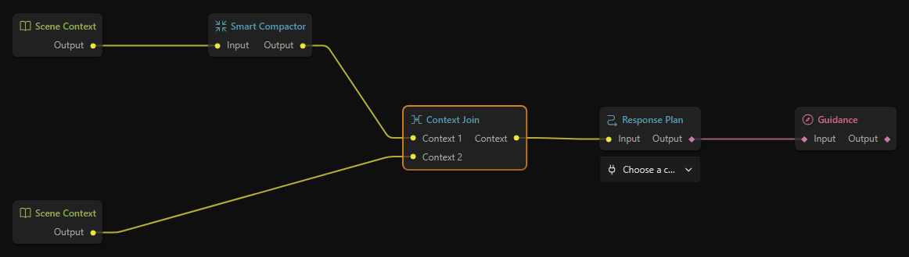

*Follow each incoming wire to see what it contributes. Left-to-right placement is for readability; wires decide which steps depend on which.*

For a yes/no story choice, use Branch and Join as explained under [decisions](#decisions-branches-and-unresolved-answers). A skipped alternative is different from an unanswered question.

## Navigate and edit the graph

Drag a node's body to move it. Drag a rectangle in empty space to select nodes, then move the set together. **Shift-click** adds a node; **Ctrl/Cmd-click** toggles it; **Alt-click** removes it from the selection.

Pan with **middle-drag** or **Space + left-drag**, including over nodes. The wheel zooms around the pointer. **[** and **]** zoom around the center of the focused graph. When zoomed far out, cards hide small controls to make the overall process easier to see. Hover, select, or focus a card to reveal its details.

Press **F** to fit the selection on screen, or to fit the whole graph when nothing is selected. **View → Center selection** moves the view without changing zoom. **View → Reset panel layout** restores the panel arrangement if you lose track of it.

### Edit, rename, and organize

Use **Edit** for copy, cut, paste, duplicate, delete, undo, and redo. These graph actions apply outside text fields; a text field keeps ordinary text-editing shortcuts. Deleting selected nodes or wires happens immediately, and Undo restores them.

Select a wire and press Delete to disconnect it. **Alt-click** a pin disconnects its bindings. **Ctrl-drag** a connected input moves its connection to another compatible input; Ctrl-drag an output moves its consumers to another compatible output. A cancelled or invalid move keeps the existing connections.

Right-click a node for its editing and output actions. **Rename** changes the display name, which is useful for names such as “Scene brief.” Details continues to identify the original tool type. **Compact card** reduces the card's displayed size while retaining its pins. These presentation edits do not change what the node does.

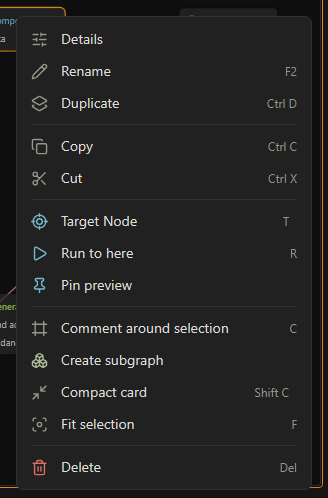

*Use a descriptive name for this instance, and compact it when you need more room. Right-clicking a selected node keeps a multiselection together.*

Use **Graph → Group selection** to keep related nodes together; **Ungroup selection** separates them. Groups can be folded on the canvas. They organize the view. A [subgraph](#reuse-a-process-with-subgraphs) goes further by packaging a process with named inputs and outputs.

Choose **File → Rename workflow…** to rename the document. Right-click a graph or subgraph tab and choose **Rename** to edit its name in place. Enter or leaving the field commits; Escape cancels. A blank name keeps the previous name.

### Arrange panels and change the theme

Use **View → Show Details**, **Show preview**, and **Show node shelf** to choose which panels are visible. The toolbar's **Details** button also toggles the right panel. Drag the left edge of Details to change its width, or the divider above the canvas to resize Preview. Their resize handles also respond to arrow keys.

Choose **View → Theme and colours…** to select Ember, Lattice, Ash, Graphite, Slate, Obsidian, Harbor, or Signal, and to customize colors. Ember follows SillyTavern's panel and text colors. Harbor uses blue and amber; Signal provides high contrast grayscale. The picker shows the type-cue legend, including pin shapes and wire patterns.

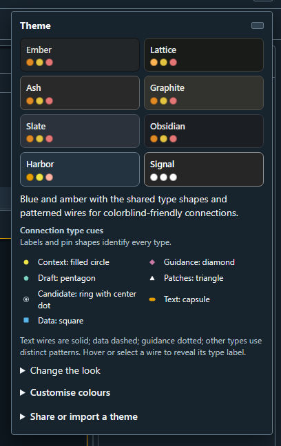

*Choose colors that make your graph easy to read. Theme changes affect appearance; they do not change connections or results.*

### Frame a section with a comment

Select a set of nodes and press **C**, or choose **Graph → Comment selection**. With nothing selected, C creates an empty comment. Give the frame a **Title**, **Notes**, and **Color** in Details.

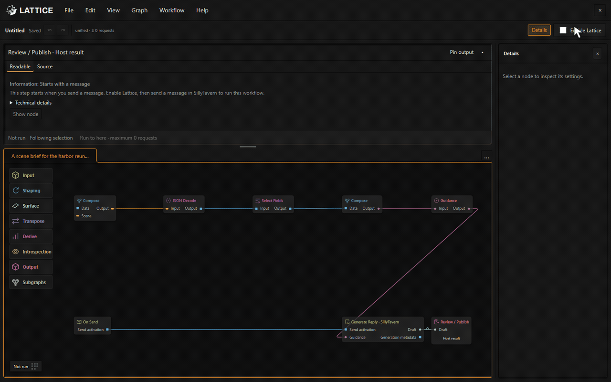

*Frame a section and name its purpose, such as “Prepare the scene brief.”*

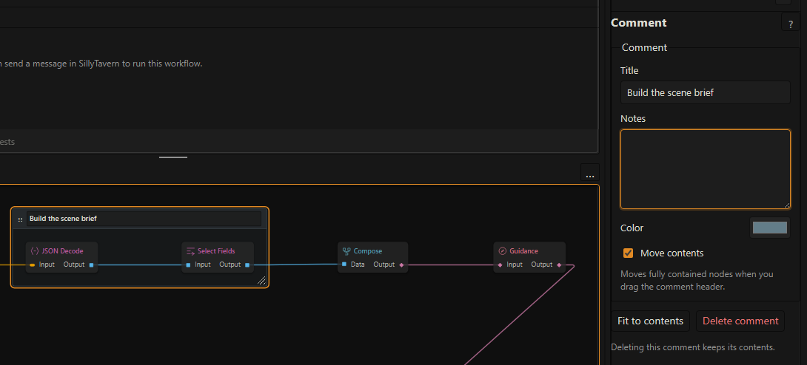

*Comments explain your graph without becoming an execution step.*

Drag the header grip to move a comment and its lower-right handle to resize it. **Move contents** decides whether dragging the frame also moves its enclosed nodes. **Fit to contents** resizes the frame around those nodes. Deleting a comment removes the frame and leaves the nodes. Select both frame and nodes if you want to copy them together. See [connections and comments](connection-comments.md) for the finer movement rules.

## Configure operations in Details

Select one node, then open Details. Its main controls explain the common settings; expandable sections hold additional options. Some nodes offer **Workflow stage** to choose Preparation or Response. Reply-editing operations need the Response stage because the reply does not exist yet during Preparation.

### Open a node guide

Click **? beside the node name**. Read the purpose and wiring advice, then the **settings/options** explanations. Expand **Example** to inspect a small working graph in the current theme.

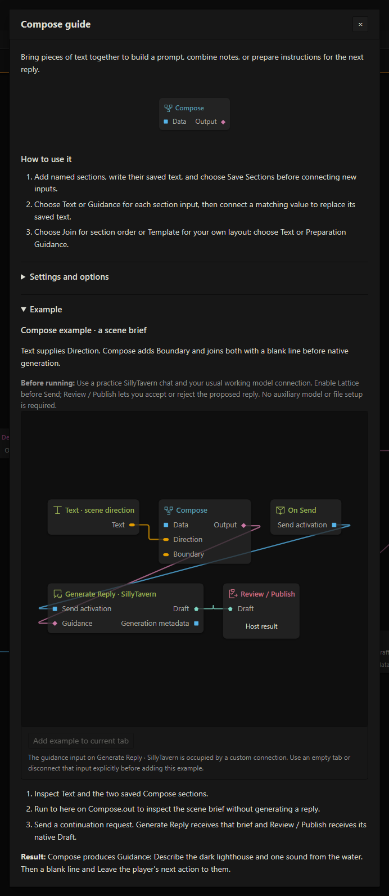

*Use Add example to current tab to try the guide's graph as one undoable edit. If the button is unavailable, read the reason below it. This example needs an empty tab or an unused Guidance input.*

The guide is the complete explanation for each tool. This manual explains the editor and common patterns, so you can work without reading the whole [node reference](node-reference.md) first.

### Familiar node settings

Prefer the normal controls for everyday editing. Lists and tables let you add, remove, and reorder rows. Structured values have controls for text, numbers, true/false, lists, and objects. Where a control has **Save …**, use it to validate and commit the whole edit.

For example, Pattern's **Rules → Terms / CSV** accepts:

| Entry | Meaning |
| --- | --- |
| `Elara` | One term. |
| `1, 2, 3` | Three string terms. |
| One term on each line | A list of terms. |
| `"red, blue", green` | The phrase “red, blue” and a separate “green” term. |
| **Plain text** mode | One term, including any commas or JSON-looking characters you typed. |

The editor shows the parsed result. Correct an error before saving. Regex expression rows keep their commas and backslashes; CSV does not reinterpret prose, templates, or file paths. Where table import is offered, map its columns, choose **Add rows** or **Replace rows**, inspect the rows, and Save.

**Edit JSON / Advanced JSON** is available for precise structured shapes. JSON is a text format for objects and lists; you usually do not need to write it by hand. An invalid JSON edit remains a draft until corrected. Drafts survive browsing to another node and returning, but unfinished editor text is not a committed workflow edit and is not included in the recovery draft. Save each settings editor before saving the workflow file.

Paths select fields inside structured Data. A path with separate key/index rows keeps a key containing a dot or comma as one key. A missing value is different from an explicit `null`, `false`, `0`, or empty string. Consult the node's **?** example for its expected structure.

Some settings change a node's pins, such as Text versus Draft input. If that would break a connected wire, Lattice rejects the change and keeps the previous node and wires. Disconnect the affected wire, change the setting, then reconnect it correctly.

### Add simple Text modifiers

Nodes with one Text output have a modifier tray at the bottom. **Trim** removes outer whitespace; **Wrap** adds configured text around the result. The add menu also provides **Whitespace**, literal **Replace**, and **Unwrap fence**.

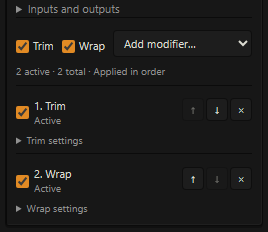

*Modifiers run in order on the Text output before downstream nodes receive it. Reorder, disable, or remove them to change the result.*

Save the modifier settings explicitly. Disabling a modifier keeps its settings. After a recorded run, Preview may show the raw source and modifier trace. A **Local modifier preview · recorded source** lets you inspect a new modifier using retained text without another model request. It does not rerun downstream nodes; run the path again to update their results. A large or incomplete recording may not support this preview.

Draft, Context, Data, and host results use their dedicated operations instead of this Text tray.

### Context and model controls

Your normal SillyTavern connection writes **Generate Reply**. Additional model nodes can follow it or use different saved connections for different jobs.

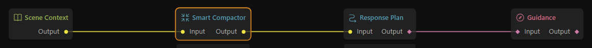

*Context preparation chooses what the planner can see. A model-backed planner is an extra call beyond the main SillyTavern reply.*

Each ordinary model node has a grey connection bar below its card. Click it to choose:

- **Active SillyTavern model** — follows the connection and model you have configured in SillyTavern. New ordinary model nodes use this option.
- **A saved Connection profile** — fixes this node to one of your local saved profiles, useful for a separate planner or editor.

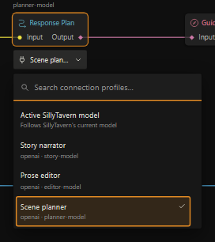

*Search by profile name, API label, or model. The profiles pictured are demonstration names; use your own working connections.*

You can make the same choice in **Details → Connection profile**. The selected profile supplies its default model. Open **Advanced model settings → Model mode → Override** only when you need this node to use another model identifier supported by that connection.

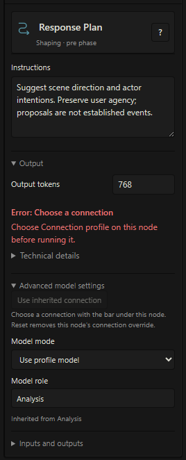

*“Choose a connection” means this node still needs a profile. Choose one on the canvas, then check its model settings here. Changing a node's profile does not switch SillyTavern's main connection.*

An unavailable saved profile stays marked unavailable until you choose a replacement. Imported workflows may need their fixed profiles assigned locally. Exported workflows do not include your credentials or local saved-profile IDs; **Active SillyTavern model** remains portable.

**For Each → Helper model bindings** needs a separate check: a reusable helper can contain several model jobs, each with its own binding. A helper with no model calls needs none. Explicit settings inside a nested helper can take precedence over an outer setting; Details reports the effective choice.

Model operations have output limits, and context tools have input budgets. **Smart Compactor** can select context without a model, or use a model to compress it. Preserve recent messages and exact protected wording where the story needs them. **Response Plan** has its own instructions and output limit. Review the recorded material rather than assuming the model saw the whole chat.

Keep the workflow open, resolve setup issues, then enable Lattice and Send. For provider errors or connection setup, see [model setup and troubleshooting](native-workflows.md).

## Run and inspect results

Use **Send** for the full enabled workflow. Use **Run to here** to test a supported output and the steps it depends on. The button states the maximum number of extra requests for that path. A maximum is a limit, not a promise that all of those requests will occur.

A path containing the main Generate Reply step needs a real Send; Run to here does not manufacture a completed SillyTavern reply. If a preview cannot run in the current context, its disabled control explains why.

While work is active, a node has a bright ring and **Stop** is available in the workflow bar or Workflow menu. A failed node has a red ring; later nodes may be blocked because their input did not succeed. Click the bottom-left run meter or choose **Workflow → Run details…** to inspect the steps, errors, and actual request usage. Subgraph stages can be expanded there.

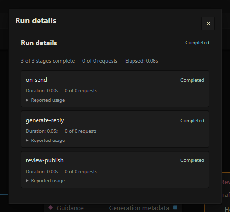

*Check what actually ran. This recorded path made zero extra requests.*

### Read Preview

Select a node to see its recorded output. If it has one output, the title identifies it directly; if it has several, choose the one you want. The result tabs show the retained parts of that output, such as its input, output, report, or Host result.

**Readable** is the default. It shows the useful content in a form you can read:

| Material | What to look for |
| --- | --- |
| Text or Guidance | The exact retained words. Check instructions, omissions, and length. |
| Context | Ordered messages with visible boundaries and source/role labels. |
| Draft or Candidate | The proposed reply wording. A retained Captured context section can be expanded separately. |
| Data | Structured fields or JSON. Check values and whether something is missing. |
| Pattern / Filter reports | Match counts, occurrences, selected lines/paragraphs, and any blocked changes. |
| Host result | The final review, proposed changes, and acceptance/save receipts. |

Choose **Source** to see the retained result record, including its metadata and wrapper fields. This is useful when you need an exact field or diagnostic detail. It shows what was recorded for that run, not a fresh read of the chat.

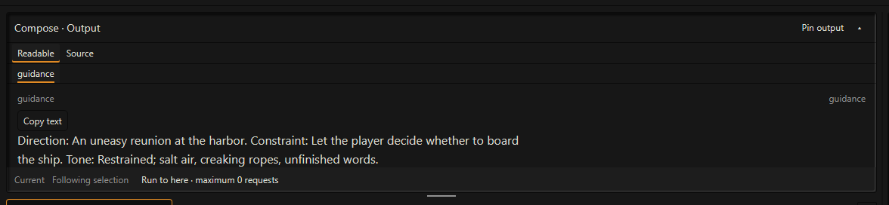

*Readable is for reading the result. Source is for inspecting its recorded structure. Switching modes makes no request.*

**Copy text**, **Copy message**, and **Copy source** copy the corresponding retained material. If a large recording was shortened or omitted, Preview says so. **Copy partial source** may contain an incomplete JSON fragment. Source view does not reveal omitted private material or recover context that was never retained.

### Hold a result while inspecting another node

Preview normally **follows selection**. Click **Pin output** to keep the current output visible while you select another node; click **Pinned output** again to resume following. The View menu offers the same controls.

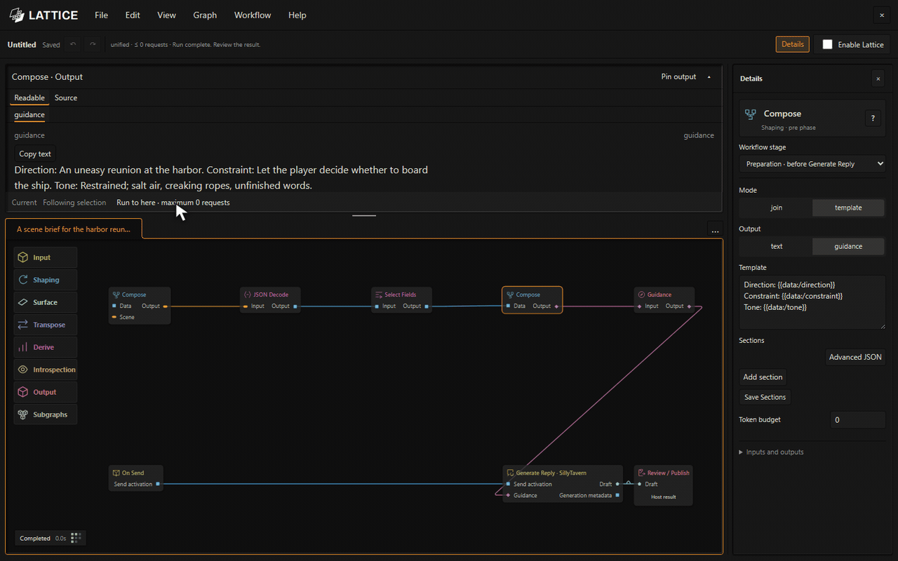

*Pin a result to compare it with another node's settings.*

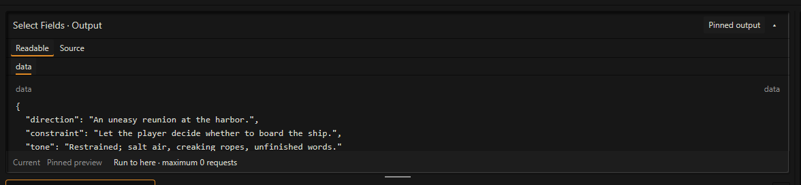

*Details and Preview can deliberately show different nodes.*

You can also select a node and press **T**, or use its **Target Node** context action, to target it in Preview. T on a different node moves the target; T on the target, or with no selection, clears it. A small icon marks the target. **Follow selection** clears targeting. Pinning and targeting change what you inspect; they do not run the workflow or freeze an old recording.

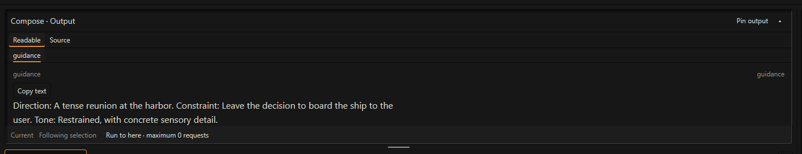

*Check the words before wiring them into Generate Reply. Current means the recording still matches the unchanged workflow.*

Changing an operation setting, modifier, stage, or connection cancels active work and makes older results **Stale**. Camera movement, selection, aliases, compact cards, and graph-tab navigation do not. You may read a stale result, but you need a fresh run or Send before accepting a result based on changed settings.

## Review a proposed reply edit

Later workflows may revise the reply, append notes, or propose story-state changes. Review those together at **Review / Publish → Host result**.

1. Send with the configured workflow enabled.
2. Select Review / Publish, or choose **Workflow → Review host result**.
3. Read the original and proposed reply, changes, findings, notes, and any staged story updates.
4. Choose **Apply reviewed reply** or **Reject reply**.


*Apply adds the reviewed version as a new swipe and accepts its attached changes. The original reply remains available.*

Only the current result from the workflow's own Send can be applied. Running an intermediate patch tool or viewing a Candidate does not give it an Apply action. A reply must remain connected as a genuine **Draft** through to Review / Publish. Turning a plain Text string into a reply-looking shape cannot replace that source relationship.

Changing the source swipe, chat, selected actor, story data, or workflow behavior can invalidate the result. Start a fresh Send when the inputs have changed. Preview and Run to here do not accept file, clock, outcome, or memory proposals. Reject and Stop do not settle pending changes that wait for acceptance either.

### Check acceptance and saving separately

An applied reply and a saved story update are separate results. Review's receipts tell you what was applied locally and which changes were confirmed saved. A notebook, clock, and outcome log can each have their own receipt; they are not one all-or-nothing disk save.

If one target saved and another failed, read the partial result. Use a supported retry only where offered. Such a retry resumes unconfirmed saving without requesting the models again, adding another swipe, redrawing an outcome, or repeating already confirmed saves. A **save unconfirmed / unknown** result needs reconciliation before affected later writes; changing a transaction key to force a repeat can duplicate the event.

See [reply review and save limits](native-workflows.md#review-a-reply-repair) for provider and host-save details.

## Save, import, and share

Save your workflow after useful changes. **Save settings** inside a node commits that editor; **Save workflow** writes the complete workflow design to a file. Apply accepts a story result. They serve different purposes.

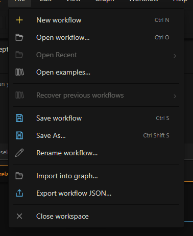

*Use Save for your editable working document, and Export workflow JSON for a copy you want to share.*

### Save a working document

In a browser that supports direct file access, choose **File → Save workflow**. On the first save, choose a destination. **Save As…** chooses another destination. If a file changed outside Lattice, use Save As rather than overwriting those changes. A cancelled picker, denied permission, or failed write leaves the draft open and modified.

Browsers without direct file access offer **Save As…** to download an editable JSON copy. Lattice cannot confirm that the browser completed the save, so the draft stays marked modified. Confirm the file in your browser's downloads. In a replacement prompt, Save As gives you the copy and keeps the current document open; repeat the opening action and choose **Don't Save** when you are ready to switch.

An editable `lattice-document` retains local connection bindings, the full graph, saved subgraph contents, overrides, and supported workspace views. It excludes credentials and runtime recall queues.

### Replace the open document deliberately

New, Open, Open Recent, examples, and recovery can replace the current document. If it has committed changes, Lattice offers **Save**, **Don't Save**, or **Cancel**.

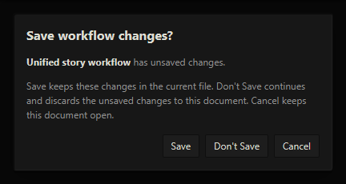

*Save completes before replacement where direct saving is available. Don't Save continues; Cancel keeps the current canvas.*

A cancelled file picker or invalid imported file also keeps your current document. **Modified** means committed authoring changes; panning, selection, tab navigation, and runtime recall queues do not mark the file modified.

### Open, recover, import, or export

| Action | Use it when |
| --- | --- |
| **New workflow** | You want a fresh Untitled workflow. |
| **Open workflow…** | You want to replace the current document with a saved editable or portable JSON workflow. |
| **Open Recent** | You want to reopen a previously accessed file in a supported browser. Permission may be requested again. |
| **Open examples…** | You want a fresh editable lesson. |
| **Recover previous workflows** | You want an earlier retained unified workflow as an unsaved draft. |
| **Import into graph…** | You want to add a compatible fragment to the graph you are already editing. |
| **Export workflow JSON…** | You want a portable `.workflow.json` copy to share. |
| **Export archived workflows** | You need the originals of retired pre/post workflows for reference or rebuilding. |
| **Close workspace** | You want to close the editor while retaining its current recovery draft and views. |

The recovery draft is retained in SillyTavern settings across reloads. It helps recover committed work, but it does not save a file on disk or include unfinished settings-editor text. **Clear Recent** clears only the recent-file list; it does not delete your files. Recent files are local to the browser and site address you used.

**Import into graph…** is additive. Review its stage requirements, model needs, final outputs, and maximum extra requests before accepting. It gives inserted nodes fresh identities and keeps their internal connections and relative arrangement. Insertion is undoable and makes no request.

Portable Export includes the complete graph and the saved definitions needed by its subgraphs. It strips local saved-profile IDs; recipients choose their own fixed profiles. Nodes set to **Active SillyTavern model** continue to follow the recipient's configured connection. Both editable and portable files open through **Open workflow…**.

Retired separate pre/post workflows remain archived originals. They cannot run, open as current documents, or import into current graphs. Export the archive to keep a recovery copy, then rebuild needed logic in a unified workflow with explicit Preparation and Response stages.

## Develop your own writing system

The remaining sections are for building beyond the starter. Begin with one story rule you can explain, preview, and verify. Use literal rules, templates, or field selection when those express the task; use a model when you need interpretation or new prose.

| Goal | Starting pattern | What to check |
| --- | --- | --- |
| Give a scene a direction | Text → Compose Guidance → Generate Reply | Exact guidance and its budget. |
| Plan from selected context | Scene Context → Smart Compactor → Response Plan | What context remained and what was omitted. |
| Add public notes | Draft → Extract → Render Notes → Append | Which records are supported and which notes will appear. |
| Clean repeated wording | Text Rules, or Pattern → Branch → Filter Text | Exact replacements or whole lines/paragraphs removed. |
| Keep a campaign notebook | Read File → Extract/Format → Write to File | Proposed document changes and accepted save receipt. |
| Run a story schedule | Story Clock → Advance Time → Clock Commit | Explicit minutes, due events, and pending remainder. |
| Reuse a working sequence | Create subgraph → Add to Subgraphs → Add system | Named inputs/outputs and connections to Main. |

[Story systems](story-systems.md) develops concrete wand, relationship, memory, and schedule ideas. The numbered examples provide complete setup. Use a separate chat for substantial experiments, and save a working version before changing it.

### Choose the right source

Start by asking what material the operation needs and whether it must stay current.

| Source | What it supplies |
| --- | --- |
| **Text** | Words you author directly. No model call. |
| **Prompt Source** | A SillyTavern prompt block; inspect raw and resolved text. |
| **File Input** | A snapshot of a local `.txt`, `.md`, or `.json` file, embedded in the workflow. Replace the file in Details to refresh it. |
| **Scene Context** | Selected story context with source and visibility information. Check its perspective and budget. |
| **Generate Reply / Reply Snapshot** | The completed reply as a source-linked Draft in the appropriate response context. |
| **Player Event Source** | The actual current player message, useful for rules before the reply is written. |
| **Read File** | A current authorized Workflow Data document, plus the live reference needed to propose a write. |
| **Memory / Actor Context** | The selected or authorized actor's stored material, with its privacy and participation checks. |

File Input does not stay linked to an operating-system file and cannot authorize a live write. Workflow Data is stored with the story; a name such as `campaign-notes.md` identifies a scoped story document, not an arbitrary path on your computer.

### Workflow Data defaults and shared sources

New **Story Clock**, **Read File**, and **Outcome Commit** nodes provide convenient starting sources:

| Node | Default source |
| --- | --- |
| Story Clock | **Chat clock**, starting at Day 1, 00:00 with a 24-hour day. |
| Read File | **Chat notes**, initially empty plain text. |
| Outcome Commit | **Chat outcomes**, initially an empty JSON list. |

A unified run supplies the referenced defaults for the active user/chat and retains saved content. In Details, change **Starting values**, **Initial content**, or **Initial outcomes** to set the template for a new source. **Load initial values** loads an existing source's template for editing. **Save settings** updates that template; it does not reset saved time, notes, or outcomes.

Open **Advanced** to choose a compatible source or use **+** beside it to create a separate named source. Notes support JSON, JSON Lines, CSV, Plain text, and Markdown. Clock and outcome sources require their JSON format. Choose **Public**, **Hidden**, or **Actor private** visibility; Actor private also requires the actor ID.

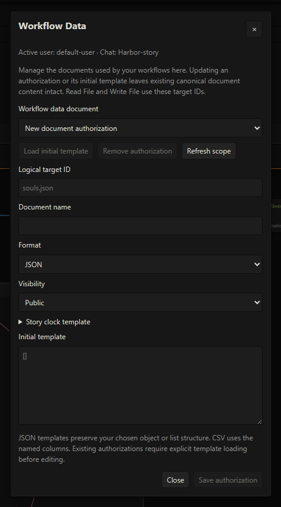

*Open Workflow → Configure → Workflow Data… to manage custom sources. Imported target names do not automatically grant access.*

For a custom source, give it a unique target ID, display name, format, visibility, and initial template. CSV requires declared columns. Updating a template leaves existing saved content intact. **Remove authorization** revokes access; it does not delete an operating-system file.

The default Chat clock is shared through Main and its systems. Default notes and outcomes inside each system have separate stable sources. Choose the same explicit source when you want systems to share a notebook or ledger. A skipped system does not create its unused defaults. Keep one final writer per shared target; two proposed writers for the same target are rejected.

Read File has Text, document Data, and reference outputs. Connect its **exact reference** to Write to File for the same target. Use Text append for plain-text/Markdown notes and structured mutations for JSON collections. **Format** checks and serializes records; **Project Document** previews the proposed updated content without saving it. Prose needs extraction before it becomes reliable structured records.

Write to File stages the change. It becomes accepted only with the corresponding reviewed reply. See [Workflow Data setup and write modes](unified-workflows.md#authorize-workflow-data-and-preserve-its-structure) for nested collections, unique IDs, and field updates.

### Story time and scheduled events

Story time is measured in the fiction. It is separate from your real clock and from message count. A journey can advance several hours; a long conversation can advance a few minutes.

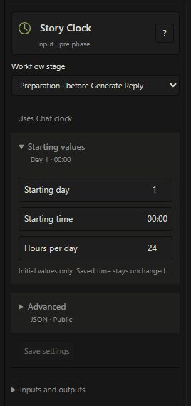

*Starting values initialize a new source. They do not rewind a timeline that already has saved content.*

A time workflow reads **Story Clock**, provides an explicit duration or destination to **Advance Time**, and stages the result through **Clock Commit**. Use forward whole story minutes. A vague phrase such as “later” needs a separate interpretation rule before it can advance time.

**Time Trigger** finds schedules crossed between the previous and proposed time. Midnight is minute `0` of a day, 14:00 is `840`, and an eight-hour interval is `480` minutes with a declared origin. Crossing a scheduled time differs from merely asking whether it is currently 14:00.

Advance Time can **interrupt** at the first due event, retaining the remaining travel/rest duration, or **catch up** through all due events within a finite limit. Inspect both occurrences and remainder. If the limit is exceeded, the projection holds rather than silently losing events.

Connect one clock to the systems that share a timeline and use one final Clock Commit for that source. Separate clocks are independent. Apply accepts the clock proposal; preview, Reject, and Stop do not advance saved time. Lessons **23** and **24** walk through time advancement and schedules.

### Recall memories deliberately

Recall brings existing authorized records into the next matching generation. It does not invent a past event. Begin with lesson **18** for native memories or lesson **26** for manual queues and story triggers.

A **Recall** node chooses the actor, memory set, target, filters, and budgets. Its records must come unchanged from a genuine authorized read, and any required presence/event evidence must be connected. Wire its private Guidance to Generate Reply for a preparation reminder, or to the authorized response operation that needs it. Simply placing Recall on the canvas does not make its words reach the reply.

To queue it manually:

1. Right-click Recall or its matching **Recall Shortcut** and choose **Queue recall**, or open **Details → Memory recall**.
2. Check the badge: green means queued; amber means reserved or pending acceptance.
3. Send the matching generation. Inspect the recall result and reviewed reply.
4. Use **Cancel recall** to cancel a queued request you no longer want.

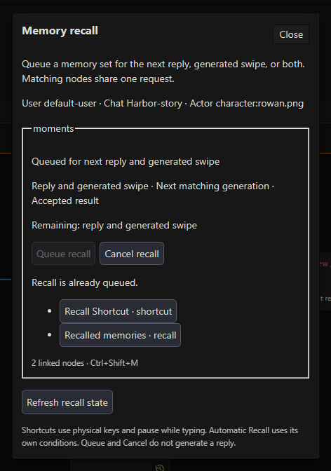

*Click a recall badge to open its controls. Workflow → Memory recall provides selected/all-node commands and a grouped overview.*

Matching Recall and Recall Shortcut nodes share a request per memory set. Queue and Cancel do not run a model, edit the document, or add Undo entries. Previewing Recall Shortcut does not queue it. Queues are temporary and are not saved with the workflow.

Recall Shortcut also lets you choose a key, target (**Reply**, **Generated swipe**, or both), repetition (**Next matching generation**, **Once for each generation type**, or **Until cancelled**), and when the queue is consumed (**Successful completion** or **Accepted result**). With Accepted result, merely completing generation does not consume it; the matching review must be accepted. Shortcuts ignore typing and key repeats, reject duplicate keys, and expire when their document or scope changes.

Recall can activate automatically from authored keyword, event, or character conditions instead. Cancellation removes a manual queue; it does not erase an authored automatic trigger. No matching record skips the reminder, while unresolved required evidence holds the path. See [Recall setup and policies](unified-workflows.md#queue-memories-manually-or-recall-them-automatically).

### Decisions, branches, and unresolved answers

Use **Condition** when a known field decides the path: “Does the destination exist?” or “Is trust at least 5?” It compares structured Data without a model call.

Use **Decision** when interpreting prose needs a model. Give it explicit questions and choices or a scoring rubric. A yes/no question uses the type called **noul** in the controls: **yes**, **no**, or **unresolved**. Unresolved means the available evidence did not establish either answer.

Extract the intended answer with **Select Fields**, then feed **Branch**. Branch sends its incoming material through **yes**, **no**, or **unresolved**. It expects a Boolean or explicit `accepted` value; it does not treat a score, a nonempty object, or confident prose as “yes.”

To bring alternatives back together, connect them to optional matching inputs on **Join**. The unchosen branch is skipped and can be omitted. A required input that was skipped, or an unresolved input, holds the output. Declare an unresolved policy deliberately: keep the original reply, request more evidence, or stop with an issue, as appropriate for your story.

**Confidence Gate** is for a numeric metric with authored acceptance/rejection thresholds and an unresolved middle range. Model-reported confidence is a model's estimate, not proof that an event happened. Lessons **9–11** teach conditional notes and decisions.

### Structured composition

**Compose** joins named sections or fills a template from Data. Choose Text for ordinary prose output, or Guidance when the result should influence Generate Reply.

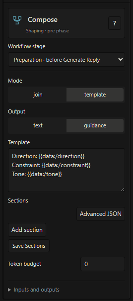

*Use section names and placeholders to make a brief from selected fields. Inspect the exact result before connecting it to generation.*

For example, JSON Decode and Select Fields can supply direction, constraint, and tone to:

```text
Direction: {{data:/direction}}
Constraint: {{data:/constraint}}
Tone: {{data:/tone}}
```

Add a field to the source, select it, and add its placeholder to Compose. A missing path produces an issue instead of silently incomplete instructions.

Each section has **Kind → Text / Guidance**, **Required input**, and **Skipped source → Use fallback text / Omit section**. Use Guidance when receiving a system's original Guidance. To make a switchable system contribute nothing when disabled, keep its section optional and choose **Omit section**. An unconnected optional section still uses its fallback; a required unresolved input holds rather than using fallback.

**Token budget** caps the complete rendered result, from 0 to 8192; 0 adds no Compose cap. Over-budget output holds instead of silently shortening the instructions. Generate Reply also has its final guidance budget. Inspect section contributions in Preview.

Private Guidance retains its intended-actor and freshness checks when merged. Copying private Text/Data into a template or changing a visibility label does not give it permission to guide another character or appear in public notes.

### Deterministic editorial rules

**Text Rules** makes literal or regex replacements without model calls. In Text mode it returns Text; in Draft mode it proposes Patches. A rule with no match makes no change.

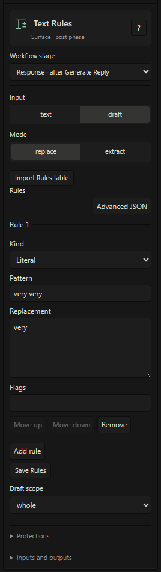

*Save Rules commits a replacement such as “very very” → “very.” Inspect the exact proposed edits before relying on them.*

For counted detection and whole-unit removal, use **Pattern → Branch → Filter Text → Join**. Pattern reports occurrences; Branch makes one routing choice for the reply; Filter Text removes or keeps whole matching lines/paragraphs. Several hits in one paragraph select it once. Detection scope and editable scope are separate settings. The report must still refer to that exact Draft; rerun Pattern after revising it.

Patch tools such as Text Rules, Validate Patches, Review Gate, and Apply Reply can provide useful intermediate inspections. Their Candidate previews are not the final publication action. A supported final Draft linked to the workflow's Send must reach **Review / Publish** for a reply you can accept. See the tool's **?** guide and [Pattern/Filter walkthrough](unified-workflows.md#detect-and-filter-a-reply) before building a cleanup path.

### Reference transformations

**Style Transfer** changes prose using a style reference, **Format Transfer** uses a layout/example, and **Terminology Map** applies a glossary. Choose **Text** input when transforming ordinary written material. Style/Format Transfer can make one extra model request; Terminology Map makes none.

For reply-edit diagnostics, choose **Draft** input in Response and connect the genuine Draft. Those tools return Patches for validation and inspection. They do not publish a reply by themselves. Mode, Scope, Strength, and Protected literals are separate settings: for dialogue characterization, choose **Mode → Character voice** and **Scope → Dialogue** explicitly. Changing Mode preserves Scope.

### Keep events, interpretations, and private state distinct

A mention of a wand is not proof it was used; a proposed kiss is not an event that occurred. Event systems keep exact story evidence and declared actor/item identities, then use normalization and confirmation before updating ownership, progression, or outcome logs. **Current Holder** needs prior ownership and ordered confirmed events; it does not guess from the nearest name.

Random Pick chooses from authored weights for a confirmed event and retains the draw on retries. Applying a result does not roll again. A fixed effect library needs no model call; recognizing the action or authoring a wild effect may use models. Lessons **19–22** and **27–28** show those paths.

For character-specific processing, keep each actor's context, memories, and private outputs on its own path. **Actor Context** and **Character Direction** require genuine authorization and participation where applicable. Only the selected native actor can receive its permitted private Guidance in the main reply. Private reflection is authored interpretation; it must not decide the player's unchosen action or become public notes through formatting.

Memory and State nodes can read or propose updates, but a proposal alone does not save it. Follow the explicit commit path and inspect the accepted receipt. **For Each** processes a bounded collection with a reusable helper; it cannot perform host generation, publication, or file/clock/outcome writes. Static systems can contain those operations, using Main's current sources and final review. The [unified guide](unified-workflows.md) covers these advanced permissions and [lessons 29–30](examples.md) demonstrate private perspectives and gradual relationships.

## Reuse a process with subgraphs

A **subgraph** is a group of operations packaged behind named inputs and outputs. Its parent shows one block; open that block to see the connected tools inside. A **system** is a reusable body connected into Main for a story job such as weather, a wand, or a relationship.

### Place and open a reusable tool

Choose a saved entry from **Subgraphs → Library** to place a copy in the current graph. Connect its typed inputs and outputs just as you would an ordinary node. The supplied [Literal cleanup subgraph](../workflows/subgraphs/literal-cleanup.json) illustrates a Draft → Patches tool for inspection.

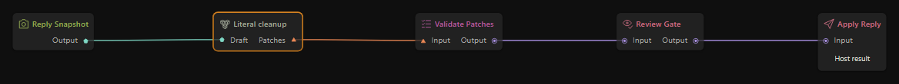

*The parent shows the tool's interface. Keep validation and final review clear outside it where appropriate.*

Double-click a subgraph to open its body in a graph tab. **Main** remains the whole workflow. Breadcrumbs identify which instance you are viewing. Each opened instance remembers its own camera and selection.

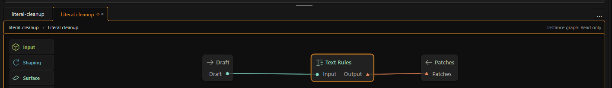

*A saved body can open read-only. Inspect its tools and connections, then return to Main through the tabs.*

Closing a body tab hides that view; it does not disable or remove the system. **Graph view actions** can reopen it. Switching tabs does not stop a run, and Stop still controls the active Main run.

### Edit one instance

Right-click the wrapper block and choose **Make editable copy** to give this instance a private body you can change. It keeps its configured settings and model overrides. Other instances keep their saved contents. Model settings inherited from the parent remain inherited unless you explicitly override them.

**Unpack subgraph** replaces one wrapper level with the nodes inside it, preserving settings, bindings, and surrounding connections.

### Create and manage definitions

To package your own process:

1. Select the nodes you want to reuse. Leave surrounding nodes outside the selection if they should stay visible in Main.
2. Right-click the selection and choose **Create subgraph**, or use the Graph menu.
3. Lattice replaces the selection with a wrapper and opens the body in a new tab. Connections crossing the selection become named typed boundaries.
4. Inspect the new interface and give its ports useful names.


*Creation preserves the connections and is one undoable edit.*

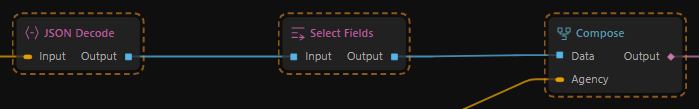

*Select the sequence that serves one clear purpose.*

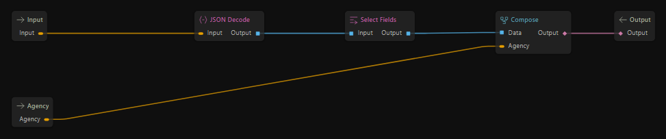

*Input blocks on the left receive material; output blocks on the right return results to the parent.*

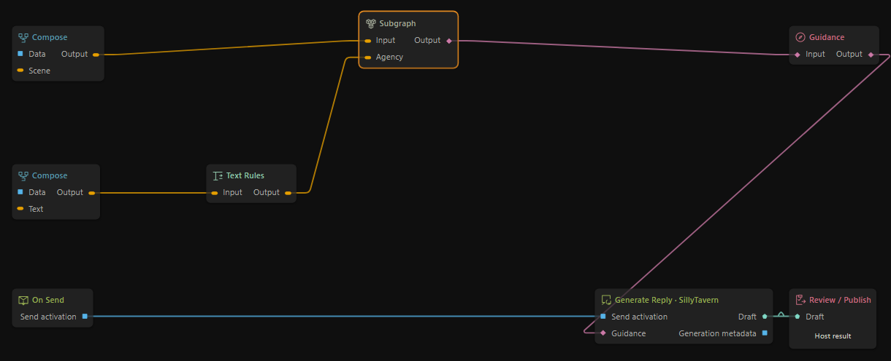

*Return to Main to check that the surrounding flow still makes sense.*

Select an input or output boundary and edit its name, artifact type, and **Required** setting in Details, then **Save port**. Add boundaries with **Subgraphs → Interface → Input / Output** inside an editable body. New inputs are optional. Disconnect incompatible wires before changing a type. Deleting a boundary removes its pin and attached body/parent connections together.

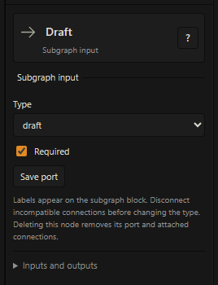

*Port names appear on the wrapper. Use them to describe what the system expects and returns.*

Right-click the wrapper and choose **Add to Subgraphs** to save it to the shelf. Name it, then choose **Save new subgraph** or explicitly update an existing entry.

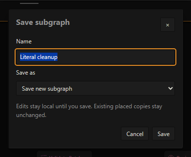

*Editing a body does not automatically update the library. Save when you want future insertions to use that version.*

Existing placed copies keep their exact saved contents when a library entry is updated. Right-click a saved shelf entry to **Open saved definition** or **Delete** it; deletion leaves placed copies intact. **Export subgraph** on a wrapper saves a portable JSON copy.

### Add a system to Main

Use **Workflow → Add system…** when composing a saved story system into the whole workflow. Save your wrapper with Add to Subgraphs first if it is not on the shelf. Add system always targets Main, even if you are viewing a body tab.

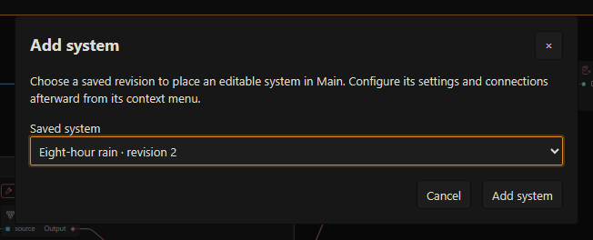

*Choose a saved revision, then Add system. Its inputs and exposed settings do not need to be configured first.*

1. Choose **Saved system**, then **Add system**. The exact saved revision is copied into an editable local instance, and its body opens in a tab. Saved exposed values are its initial settings. One Undo removes this placement.
2. Return to **Main** and right-click the placed wrapper. Choose **Configure system connections…** to edit exposed **JSON override** settings and configure connections. You can also edit the local body's nodes in their Details.
3. Bind required inputs to compatible sources when ready. **Setup Required** identifies missing effective settings; **Input Required** identifies required connections.
4. For reply guidance, explicitly choose its **Guidance output** and **Main merge destination**. Use an existing Compose Guidance merge, or **Create Compose Guidance → Generate Reply** when that generator input is empty. Bind any other used outputs to compatible destinations.
5. Choose **Preview connections**, inspect the result, then **Apply configuration**. This changes the existing instance and has a separate Undo step. **Cancel** retains the placed instance and changes no connections. If the document changes after preview, reopen the assistant and preview again.

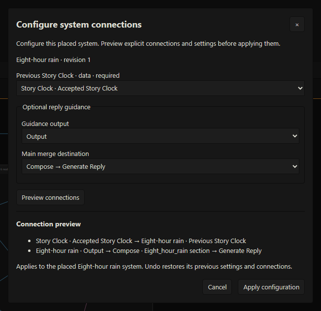

*The preview configures this existing instance. It does not insert another copy.*

Occupied pins are not silently replaced. Choose a legal merge or a free destination. Connections decide participation and influence; placing a system does not automatically inject guidance into the reply. A system that only stages state changes can participate through its staged terminals without adding prompt text.

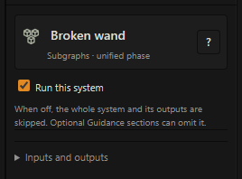

*Turn Run this system off to skip the whole body, including its model calls, reads, defaults, and proposed effects.*

Keep a disabled system's Guidance contribution optional and choose **Skipped source → Omit section** on Compose. A required consumer can still be blocked if its needed output was skipped. Disabling an ordinary primitive is not the same as the wrapper's whole-system skip; inspect its validation message.

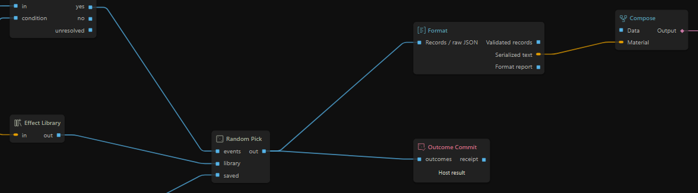

*Random Pick sends the chosen effect to Format and Compose for its written instruction, and to Outcome Commit for an outcome proposal. The enclosing workflow accepts that proposal with the reviewed reply.*

Static bodies can contain native lifecycle, file, clock, outcome, Memory, State, and Recall operations. They use the enclosing workflow's live sources and acceptance rules. Main still owns the one SillyTavern generation and final review; body tabs are views. See [combined editable systems](combined-system-example.md) for a complete composition.

## Organize connections with portals and reroutes

Use these when the graph becomes hard to read. They keep the dependencies while making the layout clearer.

### Reroutes

Double-click a direct wire to insert a typed **Reroute**, or add one from **Shaping**. Move it to guide the wire around other nodes. Shelf-added reroutes start as Text; select **Artifact kind** in Details for another type. If a type change would invalidate a wire, Lattice keeps the previous type and connections until you resolve it.

### Portals

A **portal** names an existing output so distant inputs can refer to it without a long visible wire. It carries the same result and preserves its type and dependency.

1. Open **Graph → Manage portals…**, or use the relevant wire/output context action.
2. Choose an **Output**, enter a **New portal name**, and **Create portal**. A wire/output opened from its context can offer conversion directly.
3. Select the portal, choose a **Compatible receiver**, then **Connect receiver**. If it already has a wire, replacing it requires the explicit replacement choice.
4. Use **Jump to source** or a consumer's **Jump** to inspect either end.

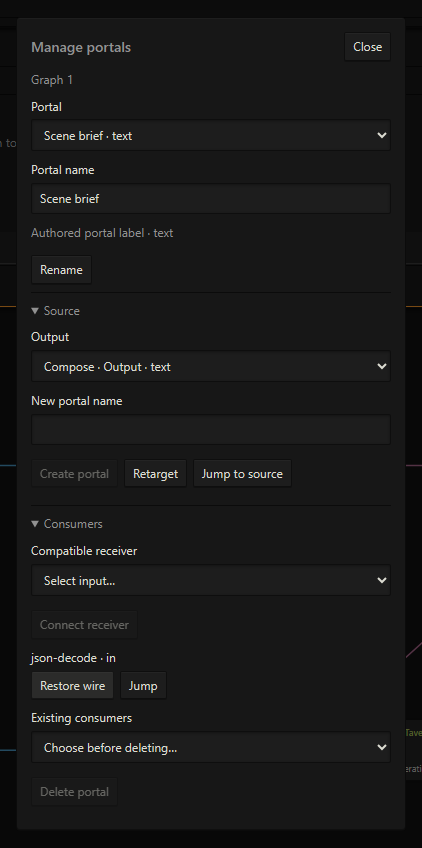

*Use a name that describes the result, such as “Current scene brief.” Restore wire makes a consumer's connection visible again.*

The manager also supports renaming and retargeting. Before deleting a portal with consumers, choose whether to **Restore visible wires** or **Disconnect consumers**. A portal cannot reach across a subgraph boundary; expose an input/output port for that crossing. In read-only bodies, available label changes may be local presentation labels rather than exported edits.

Use comments for explanations, groups for arranging nodes, reroutes for wire layout, portals for distant connections, and subgraphs for reusable processes. Start with whichever solves the specific readability problem.

## Troubleshoot a workflow

Choose **Workflow → Validate workflow** before running an unfamiliar or substantially edited graph. Read the plain-language issue, choose **Show node** when available, and fix that node or connection. Expand **Technical details** when a diagnostic code helps you investigate or report the problem.

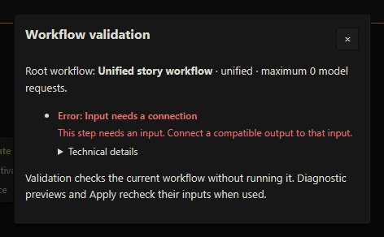

*This starter is missing its final Draft connection. Connect Generate Reply to Review / Publish, then validate again.*

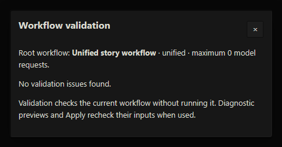

*Validate again after fixing the issue. A clear report checks structure and setup; it does not test what a provider will return or whether the story wording is good.*

| What you see | What to do |
| --- | --- |
| Send ignores the workflow | Check Enable Lattice and the open document name, then validate. |
| Run to here is disabled | Read its reason. The output may need a real Send, a completed reply, or missing setup. |
| Choose a connection / unavailable profile | Select a working Active or saved profile on that model node; check For Each helper bindings separately. |
| Incompatible input | Follow the wire and compare types. JSON Text needs decoding before a Data consumer. |
| Missing required input / final review | Connect the required pins, confirm the stage, and ensure a genuine final Draft reaches Review / Publish. |
| A system is skipped or blocks a consumer | Check Run this system, input optionality, and Compose's Skipped source setting. |
| No recorded output | The step may not have run or participated. Select the right output and inspect Run details; recording limits may omit it. |
| Stale result / Apply unavailable | Something changed after the result was produced. Make a fresh Send with the intended chat, actor, and workflow. |
| Missing Workflow Data | Choose or authorize the compatible source for the current user/chat/actor. An imported name is not authorization. |
| Recall does not appear in the reply | Check its queue/automatic condition, matching records, target, actor/presence, and wire into the operation that needs Guidance. |
| Save failed or is unconfirmed | Read the individual receipt. Retry only where offered; an unknown result may need reconciliation. |
| An edit did not take effect | Leave a normal field to commit it, or use its Save action. Invalid JSON is still a draft. |
| You lost the graph or panel layout | Press F to fit, or use View → Reset panel layout. |

For a provider error, inspect the failing node's effective connection and model, its request limit, and the actual request report. [Model setup and troubleshooting](native-workflows.md) covers supported routes and host-save limits. For old workflow files, use [migration and recovery](unified-workflows.md) and keep an exported archive of their originals.

When reporting an issue, include the Lattice version, what action failed, its plain-language error and Technical details, and a minimal portable workflow when useful. Inspect shared files/screenshots for story material before posting them.

## Keyboard and connection reference

These shortcuts apply when the graph is focused, outside typing fields. Menus show the shortcuts beside their actions, and **Help → Keyboard shortcuts** provides an in-editor reference.

| Gesture | Action |
| --- | --- |
| Empty-space drag | Rectangle-select nodes. |
| Shift-click / Shift-rectangle | Add to selection. |
| Ctrl/Cmd-click | Toggle a node. |
| Ctrl/Cmd-rectangle | Add to selection. |
| Alt-click / Alt-rectangle | Remove from selection. |
| Middle-drag / Space + left-drag | Pan. |
| Wheel | Zoom around pointer. |
| [ / ] | Zoom around the center of the focused graph or Node Guide example. |
| F | Fit and center selection; fit graph if nothing is selected. |
| Ctrl/Cmd+A | Select all. |
| Ctrl/Cmd+Z / Ctrl/Cmd+Shift+Z | Undo / redo. |
| Ctrl/Cmd+C / X / V | Copy / cut / paste. |
| Ctrl/Cmd+D | Duplicate selection. |
| Ctrl/Cmd+G / Ctrl/Cmd+Shift+G | Group / ungroup selection. |
| C | Frame selected nodes with a comment, or add an empty comment. |
| F2 | Rename the selected node's display name. |
| Shift+C | Toggle Compact card on the focused graph card. |
| R | Run to the selected node where the output supports a preview. |
| T | Target the selected node in Preview; repeat to clear, or use another node to move the target. |
| Click wire | Select a connection. |
| Shift/Ctrl-click wire | Extend connection selection. |
| Delete / Backspace | Delete selected nodes or connections; Undo restores them. |
| Alt-click wire / pin | Disconnect the wire / pin's bindings. |
| Ctrl-drag connected input | Move its binding to another compatible input. |
| Ctrl-drag output | Move its consumers to another compatible output. |
| Double-click direct wire | Insert a typed Reroute. |
| Right-click pin | Break bindings or navigate to a connected source. |
| Double-click subgraph | Open its body in a graph tab. |
| Ctrl/Cmd+S | Save workflow, or Save As where direct saving is unavailable. |
| Ctrl/Cmd+Shift+S | Save As in a browser with direct file access. |
| Escape | Cancel an unfinished gesture or chooser. |

Zoom/fit keys are ignored while typing or dragging. Invalid connection moves preserve the current wires. Context menus also support arrow keys, Enter, Home/End, and Escape; Right/Left enters or leaves output submenus.
