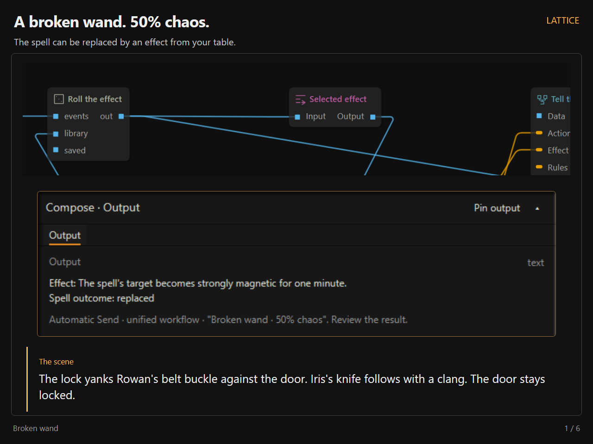
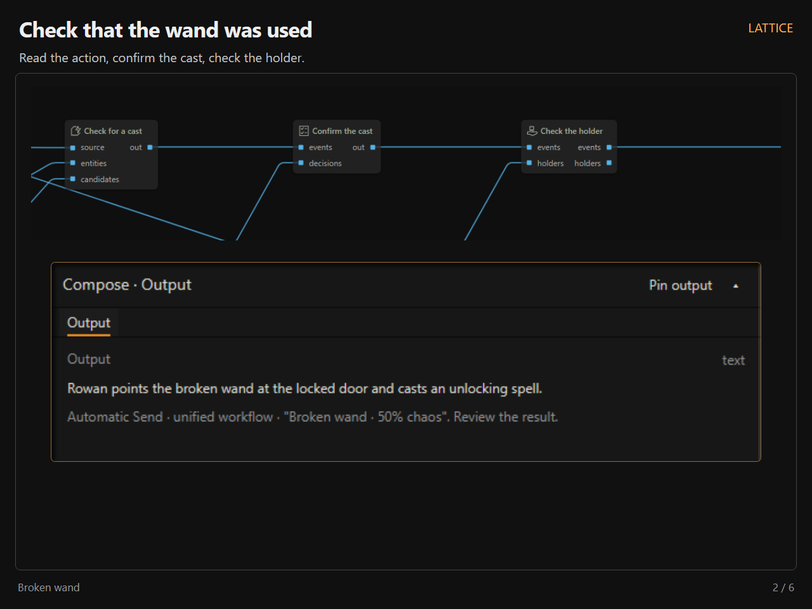
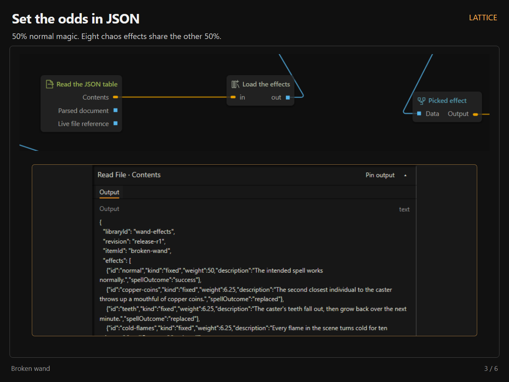
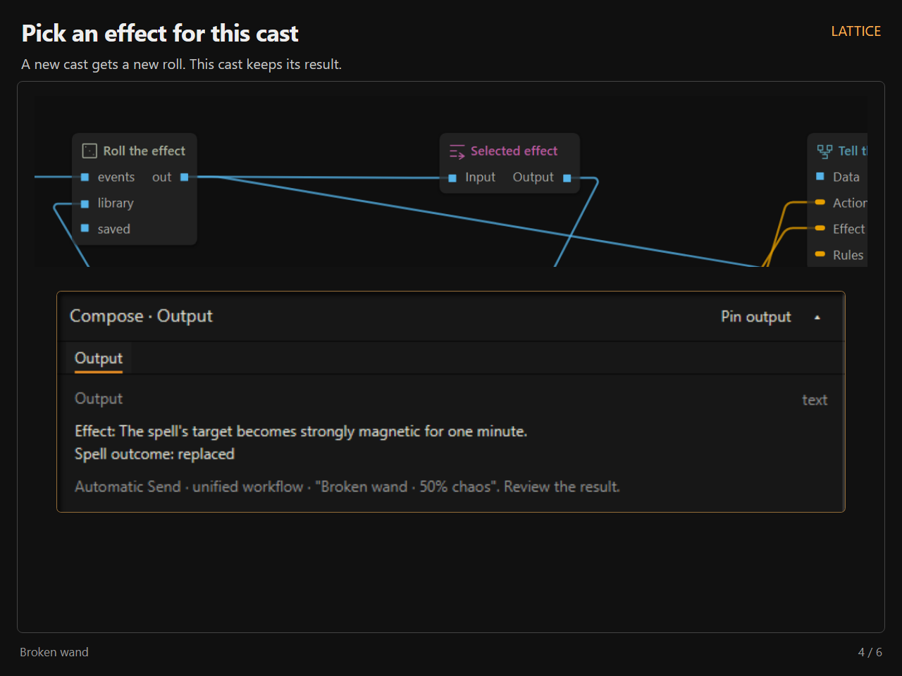
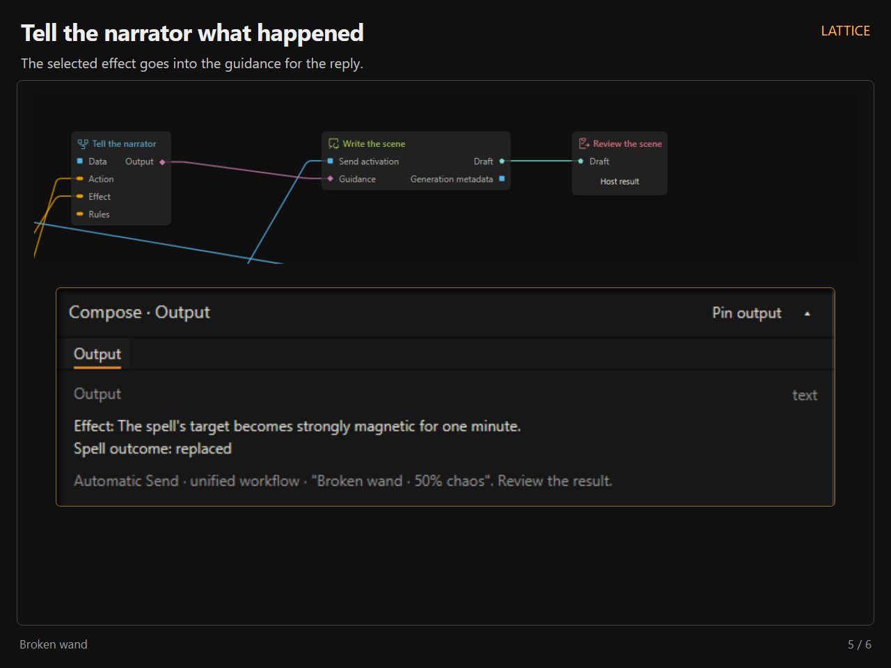
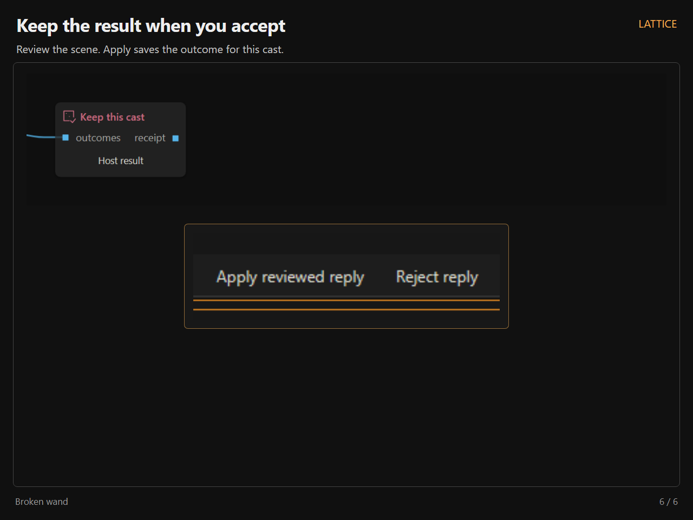

# Lattice release media

Six annotated PNGs and three silent H.264 MP4s, all at 1280 × 960. The videos run at 30 fps. The latest editor walkthrough is 50 seconds; the earlier 20- and 35-second clips are retained.

[Download the 50-second walkthrough](https://raw.githubusercontent.com/MentallyQuill/Lattice/main/docs/release-media/2026-10-10/lattice-editor-walkthrough-50s.mp4) · [Earlier 35-second clip](lattice-editor-walkthrough.mp4) · [20-second overview](lattice-in-20-seconds.mp4) · [Workflow](broken-wand-50-50.lattice.json) · [Effect table](wand-effects.json) · [Example holder](wand-holders.json)

## Images

Each image has its own direct link. Open an image to view or save the full PNG.

## Clips

The 20-second overview shows opening an example, adding a node, connecting pins, and creating a subgraph.

The 50-second walkthrough has six labeled sections:

- 0–7 seconds — Example Workflows: File → Open examples → load a shipped lesson.
- 7–17 seconds — Node Shelf: Search Text Rules, drag it onto the canvas, and complete node creation.
- 17–25 seconds — Connecting Nodes: Route the existing Text through Text Rules into Compose.
- 25–32 seconds — Node Settings: Save a literal replacement in Details, changing “problem” to “mystery.”
- 32–40 seconds — Preview: Run to Compose, pin its recorded output, and inspect the original Text alongside it.
- 40–50 seconds — Subgraphs: Select the three preparation nodes, create a subgraph, inspect its retained settings, and return to the parent.

Each section has a short label at the top of the screen, slower pointer movement, and pauses to show the result. Details stays visible. The video follows one editable copy of lesson 2 throughout; Run to here executes the real deterministic preparation chain without a model request or publishing a reply.

## Wand

The normal spell has weight 50. Eight fixed chaos effects have weight 6.25 each. Chaos replaces the spell. The downloadable workflow is a variation of shipped lesson 27; configure its actors, documents, and models before using it.

## Capture provenance

The editor, menus, mouse gestures, wires, extraction, typed boundaries, and recorded operation outputs are real production Lattice UI. The local host uses sample story data. For the screenshot run, candidate extraction and confirmation are supplied demo inputs, and the native reply is authored demo prose. Random Pick uses unmodified runtime randomness; normal results are rejected and subsequent separate casts are tried until a chaos result occurs. The table and probabilities are not altered for capture. No model provider is contacted. The final screenshot shows review and a staged outcome, before Apply.

Use the PNGs in numeric order. The direct links above can be shared independently.
